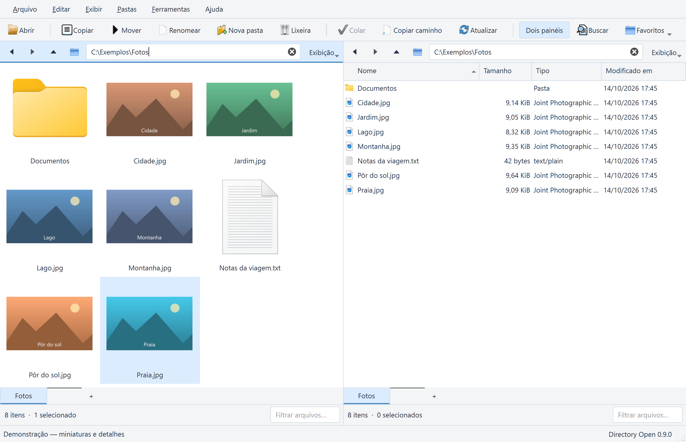
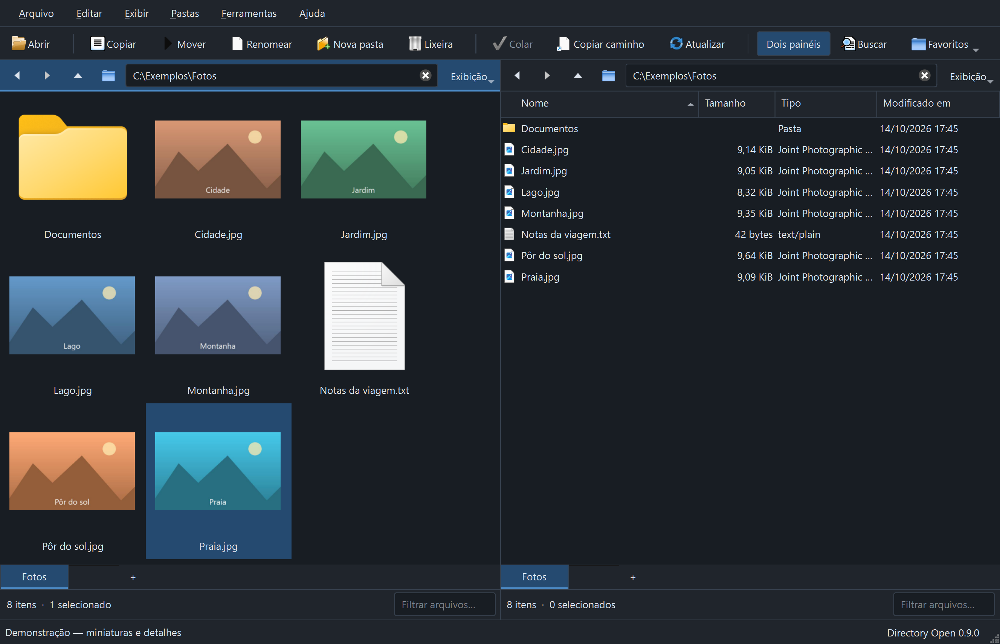
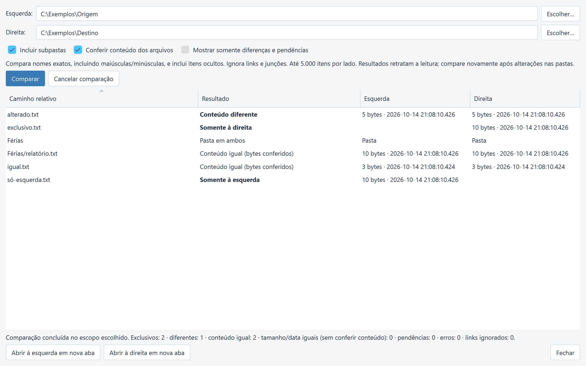

# Directory Open

Gerenciador de arquivos para Windows, com dois painéis, abas, busca, operações
nativas e visualizador de imagens, texto, PDF, áudio e vídeo. **DirOpen** é a forma curta e
**DirOpen.exe** é o executável. Interface em português, com temas claro e escuro.

Projeto independente, inspirado na organização de gerenciadores como o Directory
Opus. Não é produto da GPSoftware e não contém código, imagens ou componentes do Opus.

**Versão 0.11.0 — em desenvolvimento.** O código foi compilado e testado localmente
no Windows. Ainda não há pacote de download validado em outra máquina. A compilação e os testes também são executados no GitHub Actions.
Veja o [resultado mais recente](https://github.com/romulocampelo/directory-open/actions/workflows/windows.yml).

As capturas usam imagens e caminhos ilustrativos de demonstração.

## O que já funciona

- Dois painéis, árvore, abas, histórico, filtros e ordenação.
- Copiar, mover, renomear, criar pastas e enviar à Lixeira, com confirmação,
  progresso, cancelamento e resultados por item.
- Renomeação em lote com prévia, numeração, substituição literal e datas.
- Área de transferência do Windows e arraste entre painéis.
- Busca por nome em subpastas e favoritos editáveis.
- Comparação de pastas por tamanho/data ou conteúdo, com subpastas e cancelamento.
- Exibição guardada por pasta, incluindo colunas e tamanho das miniaturas.
- Miniaturas de imagens, com carregamento em segundo plano e cache limitado.
- Visualizador de imagens, texto, PDF, áudio e vídeo: F7 no painel, F3 ampliado e F11 em tela cheia.
- Sessão com backup, gravação atômica e proteção contra sobrescrita concorrente.

Os limites e comportamentos estão no [manual de uso](docs/USO.md). PDF não tem
pesquisa/seleção de texto; Office e arquivos compactados ainda não foram implementados.
Mídia depende dos formatos/codecs disponíveis no Qt distribuído; não inicia automaticamente. Não há paridade de recursos com o Opus.

## Compilar e executar

Requisitos: Windows x64, Qt 6.8 ou superior para **MSVC 2022 x64** com Widgets/Test e Multimedia/MultimediaWidgets,
Visual Studio com ferramentas C++ x64 e Windows SDK com cabeçalhos C++/WinRT,
CMake 3.21 ou superior e Ninja. O caminho local padrão do Qt é 6.12.0; a CI usa
6.8.3. Não é necessário instalar Qt PDF ou um leitor Adobe para o visualizador.

No PowerShell, a partir da pasta do repositório:

~~~powershell
# Ajuste somente se o Qt estiver em outra pasta:
$env:NAVEGA_QT_DIR = 'C:\Qt\6.12.0\msvc2022_64'
& .\build.cmd
& .\IniciarDirOpen.cmd
~~~

Execute os arquivos .cmd inteiros; não cole suas linhas internas no PowerShell.
O primeiro uso do inicializador compila se o executável ainda não existir.
Para recompilar após alterações, execute build.cmd. A pasta build é gerada.
O script usa ferramentas já instaladas e altera o ambiente apenas do seu processo.

Veja [COMPILAR.md](docs/COMPILAR.md) para configurar caminhos, executar testes e
iniciar uma sessão isolada. Para executar um pacote futuro, o requisito será o
runtime MSVC e as bibliotecas incluídas no pacote; o SDK é para desenvolvimento.

## Desenvolvimento e contribuição

A versão 0.11 reúne onze suítes, incluindo renomeações nativas e reprodução real
de arquivos próprios WAV e AVI/MJPEG. A execução local passou, com cinco omissões
explícitas nos testes offscreen; os novos recursos também são verificados no desktop Windows. Veja [como verificar](docs/COMPILAR.md).
A verificação automática compila e executa CTest no Windows; ela não comprova um
instalador, um segundo computador nem todos os fluxos interativos do desktop.

- [Como contribuir](CONTRIBUTING.md)
- [Histórico de versões](CHANGELOG.md)
- [Próximas etapas](ROADMAP.md)
- [Arquitetura e cuidados](docs/ARQUITETURA.md)
- [Preparar uma versão para distribuição](docs/LANCAMENTOS.md)

## Licença

Código próprio sob [MIT](LICENSE). A atribuição histórica a Navega contributors
foi preservada; Navega era o nome anterior. Qt e outros componentes mantêm suas
próprias licenças. A MIT deste repositório não licencia novamente essas bibliotecas.
Avisos e requisitos de distribuição são tratados em [LANCAMENTOS.md](docs/LANCAMENTOS.md).
