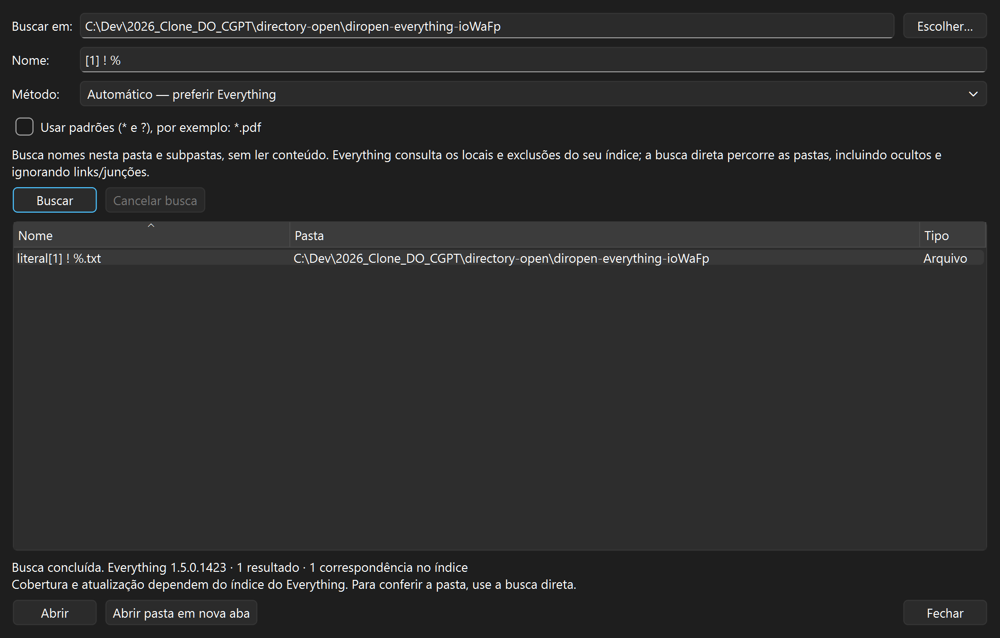

# Directory Open

Gerenciador de arquivos para Windows, com dois painéis, abas, busca, operações
nativas e visualizador de imagens, texto, PDF, áudio e vídeo. **DirOpen** é a forma curta e
**DirOpen.exe** é o executável. Interface em português, com temas claro e escuro.

Projeto independente, inspirado na organização de gerenciadores como o Directory
Opus. Não é produto da GPSoftware e não contém código, imagens ou componentes do Opus.

**Versão 0.24.0 — publicação dos fontes.** O código foi compilado e testado localmente
no Windows. Ainda não há pacote de download validado em outra máquina. A compilação e os testes também são executados no GitHub Actions.
Veja o [resultado mais recente](https://github.com/romulocampelo/directory-open/actions/workflows/windows.yml).

As capturas usam imagens e caminhos ilustrativos de demonstração.

## O que já funciona

- Preferências de aparência, painéis, barras, menu pessoal e atalhos; perfis
  importáveis/exportáveis e central pesquisável de comandos. Veja o
  [inventário de telas e opções](docs/INTERFACES.md).
- Árvores independentes, abas bloqueadas/grupos, filtros combinados, agrupamento,
  layouts nomeados e editor de barras/menus/componentes, com atalhos globais opt-in.
- Dois painéis, árvore, abas, histórico, filtros e ordenação.
- Duplo clique em arquivos abre o programa padrão do Windows; pastas navegam no painel.
- Copiar, mover, renomear, criar pastas e enviar à Lixeira, com confirmação,
  progresso, cancelamento e resultados por item.
- Renomeação em lote com prévia, numeração, substituição literal e datas.
- Histórico persistente dos novos lotes e desfazer com prévia e confirmação.
- Área de transferência do Windows e arraste entre painéis.
- Cópia opcional com o TeraCopy instalado, com execução acompanhada na janela dele.
- Fila própria com ordem, pausa/cancelamento e revalidação; sincronização por
  cópia com prévia, direção e conflitos, sem propagar exclusões.
- Criar ZIP/7z, listar, testar integridade e extrair com 7-Zip, pela interface do DirOpen.
- Buscar conteúdo com ripgrep, criar/restaurar versões locais com restic e
  transferir pastas por conexões rclone, com prévia, confirmação e resultados.
- Consultar/editar metadados em cópias com ExifTool, converter imagens com
  ImageMagick e converter/extrair áudio/vídeo com FFmpeg/ffprobe.
- Menu clássico do Windows com extensões instaladas e submenu dos comandos próprios.
- Busca por nome/caminho em subpastas, filtros de tamanho/data/tipo, instância Everything, alternativa direta e favoritos editáveis.
- Comparação de pastas por tamanho/data ou conteúdo, com subpastas e cancelamento.
- Tamanho sob demanda, listagem opt-in limitada e relatórios CSV/TXT, prévia paginada/PDF e impressão com cobertura explícita.
- Exibição guardada por pasta, incluindo colunas e tamanho das miniaturas.
- Miniaturas de imagens, primeira página de PDF e primeiro quadro de vídeo, em segundo plano.
- Visualizador de imagens, texto, PDF, áudio e vídeo: F7 no painel, F3 ampliado e F11 em tela cheia.
- Pesquisa entre páginas do PDF, destaque de ocorrências, seleção com mouse e cópia de texto.
- Sessão com backup, gravação atômica e proteção contra sobrescrita concorrente.
- Preferências do visualizador, classificações/triagem, prévia textual de
  Office/OpenDocument e OCR local da imagem/página exibida.
- Acesso explícito ao duplicador Python e assistente interativo rclone.
- Scripts Python com formulários JSON, código revisado e consentimento por execução.
- Consulta de associações e escolha na tela oficial do Windows; Abrir pastas
  físicas opt-in por usuário, com backup, recuperação e restauração.

Os limites estão no [manual de uso](docs/USO.md) e no [inventário](docs/COBERTURA-INTERFACES.md),
com suas 25 capacidades cobertas no escopo documentado. Office é prévia textual,
sem macros ou paginação completa; OCR aplica-se à prévia raster. ZIP/7z e leitura
de RAR em arquivo único são suportados; opções adicionais abrem explicitamente
o gerenciador 7-Zip externo, sem recibo integrado. Scripts têm permissões completas
do usuário, sem sandbox/autorun. A integração de pastas não cobre Win+E ou locais
virtuais e foi validada em registro isolado, preservando as associações pessoais.
Mídia depende dos formatos/codecs disponíveis no Qt distribuído; não inicia automaticamente. Não há paridade de recursos com o Opus.

## Compilar e executar

Requisitos: Windows x64, Qt 6.8 ou superior para **MSVC 2022 x64** com Widgets/Test, Multimedia/MultimediaWidgets e **PDF**,
Visual Studio com ferramentas C++ x64 e Windows SDK,
CMake 3.21 ou superior e Ninja. O caminho local padrão do Qt é 6.12.0; a CI usa
6.8.3. Qt PDF é uma dependência do build e do pacote; não é necessário um leitor Adobe.

No PowerShell, a partir da pasta do repositório:

~~~powershell
# Ajuste somente se o Qt estiver em outra pasta:
$env:NAVEGA_QT_DIR = 'C:\Qt\6.12.0\msvc2022_64'
& .\build.cmd
& .\IniciarDirOpen.cmd
~~~

Execute os arquivos .cmd inteiros; não cole suas linhas internas no PowerShell.
O inicializador aponta para o build local mais recente validado. Esse destino acompanha cada entrega
de desenvolvimento, pois o uso diário também serve de teste no mundo real.
Se esse build não estiver presente, compila as fontes atuais em `build/` antes
de abrir. Argumentos como `--no-session` são encaminhados ao aplicativo.
Para recompilar após alterações, execute build.cmd. A pasta build é gerada.
O script usa ferramentas já instaladas e altera o ambiente apenas do seu processo.

O [processo de empacotamento local](docs/LANCAMENTOS.md#candidato-local-automatizado)
prepara uma pasta isolada e ZIP com inventário/hashes e permite verificar a abertura
sem caminhos de desenvolvimento. É um candidato de teste; as licenças/fontes completas
e a validação em outro Windows ainda precisam ser concluídas antes de redistribuir.

Veja [COMPILAR.md](docs/COMPILAR.md) para configurar caminhos, executar testes e
iniciar uma sessão isolada. Para executar um pacote futuro, o requisito será o
runtime MSVC e as bibliotecas incluídas no pacote; o SDK é para desenvolvimento.

Para diagnóstico e reinstalação do componente PDF, veja
[REPARAR-PDF.md](docs/REPARAR-PDF.md). Reinstalação do mesmo pacote não resolve
documentação de terceiros ausente na origem.

## Desenvolvimento e contribuição

A versão 0.24 passou localmente em 34 suítes CTest, incluindo relatórios, tamanho,
PDF, mídia, operações nativas e os contratos de empacotamento. Casos opcionais
omitidos (como benchmarks e integrações reais opt-in) permanecem explícitos nos
resultados; a execução padrão não comprova todos os cenários interativos nem
ferramentas externas ausentes. Veja [como verificar](docs/COMPILAR.md).
Uma verificação adicional em PowerShell cobre integridade e contratos do pacote.
A verificação automática compila e executa CTest no Windows; ela não comprova um
instalador, um segundo computador nem todos os fluxos interativos do desktop.

- [Como contribuir](CONTRIBUTING.md)
- [Histórico de versões](CHANGELOG.md)
- [Próximas etapas](ROADMAP.md)
- [Arquitetura e cuidados](docs/ARQUITETURA.md)
- [Preparar uma versão para distribuição](docs/LANCAMENTOS.md)

## Licença

Código próprio sob [MIT](LICENSE). A atribuição histórica a Navega contributors
foi preservada; Navega era o nome anterior. Qt e outros componentes mantêm suas
próprias licenças. A MIT deste repositório não licencia novamente essas bibliotecas.
Avisos e requisitos de distribuição são tratados em [LANCAMENTOS.md](docs/LANCAMENTOS.md).
