# Interfaces e personalização

Inventário atualizado em 17/10/2026. O pedido de aperfeiçoar as interfaces passou a ser a
etapa atual, substituindo a prioridade anterior de deixar toda estética por último.
Este documento separa recursos utilizáveis de funcionalidades ainda necessárias;
não representa paridade completa com o Directory Opus.

As 25 capacidades do inventário possuem interfaces funcionais na versão local
0.21, com limites e verificação registrados em [COBERTURA-INTERFACES.md](COBERTURA-INTERFACES.md).

## Acesso às telas

**Configurações → Central de comandos**, ou **Ctrl+Shift+P**, permite procurar
ações por nome e categoria. Um comando desabilitado conserva a condição de sua
ação original: selecione os arquivos apropriados ou conclua a tarefa atual.
A central reutiliza as mesmas ações dos menus e da barra, incluindo suas
confirmações. Não executa operações de arquivos por um caminho alternativo.

| Área | Tela/acesso no DirOpen | Situação |
|---|---|---|
| Janela de arquivos | Um/dois painéis, abas, árvores compartilhada/independentes, locais e favoritos | 0.21: uma árvore por painel em Configurações, acompanhando sua navegação |
| Exibição por pasta | Botão Exibição de cada painel; também Exibir → Exibição da pasta ativa | Detalhes, nomes, miniaturas, colunas, ordenação e exibições guardadas disponíveis |
| Favoritos | Pastas → Organizar favoritos | Disponível |
| Operações | Editar e central: copiar, mover, colar, renomear, pasta, Lixeira | Confirmação e resultados; fila própria em Editar → Fila de operações (Ctrl+Alt+Q) |
| Lotes | Ferramentas → Renomear em lote / Histórico de renomeações | Receitas nomeadas de regras ordenadas, prévia e histórico disponíveis |
| Busca de nomes/caminhos | Ferramentas → Buscar | 0.22: filtros compartilhados de tamanho/data/tipo e escolha de instância Everything já aberta |
| Conteúdo | Ferramentas → Buscar conteúdo | ripgrep disponível; extração PDF/Office pendente |
| Comparação | Ferramentas → Comparar pastas | Comparação e sincronização por cópia com prévia e direção explícita |
| Compactados | Ferramentas → Criar/Abrir compactado | ZIP/7z e leitura de RAR em arquivo único; opções avançadas no 7-Zip externo |
| Backup | Ferramentas → Backups com versões | restic disponível no escopo documentado |
| Remotos | Ferramentas → Armazenamento remoto | Navegação/cópia e assistente interativo delegado para configurar contas |
| Metadados | Ferramentas → Metadados | ExifTool disponível em cópias; propriedades integradas ao painel e edição direta pendentes |
| Imagens | Ferramentas → Converter imagens | ImageMagick disponível; classificação e triagem com catálogo próprio disponíveis |
| Áudio/vídeo | Ferramentas → Áudio e vídeo | FFmpeg/ffprobe disponíveis nos perfis documentados |
| Visualizador | F7 prévia, F3 ampliado, F11 tela cheia | Prévia textual Office/OpenDocument e OCR local da prévia disponíveis |
| Duplicatas | Ferramentas → Duplicatas no aplicativo Python | Abertura explícita e locais sugeridos; migração do motor permanece posterior |
| Scripts | Ferramentas → Scripts e formulários | Formulários JSON, Python escolhido, código revisado e consentimento por execução |
| Associações | Configurações → Associações e abertura de pastas | Consulta e Windows Apps padrão; Abrir pastas físicas opcional com backup/reversão |

## Busca ampliada na 0.22

**Ferramentas → Buscar** permite escolher nome ou caminho completo, filtros de
bytes/datas/padrões/tipos/ocultos e uma instância Everything já aberta.
Os filtros reutilizam as regras da navegação. Datas e tamanhos são inclusivos;
as opções de arquivos/pastas permanecem explícitas. O índice informa candidatos,
e a busca confere os metadados atuais antes de acrescentar resultados.

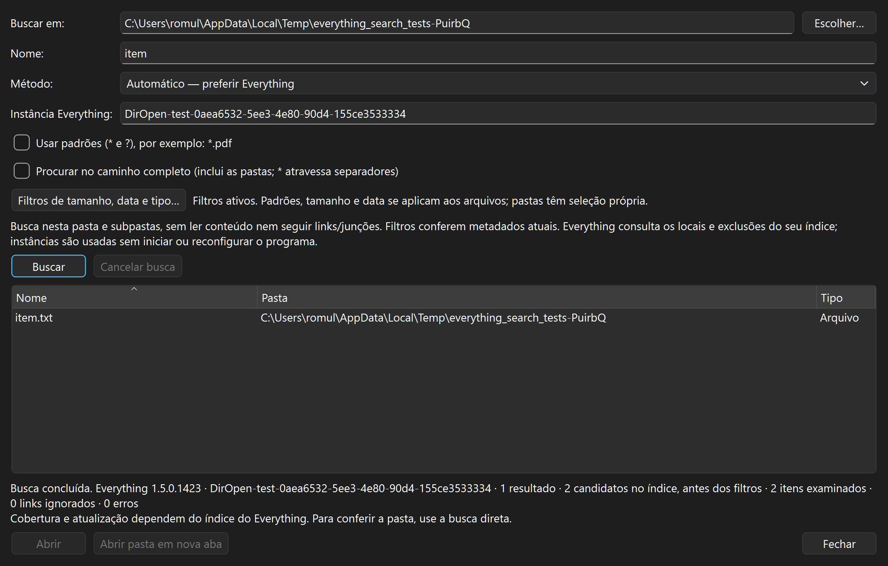

A captura usa arquivos temporários e uma instância de protocolo de teste própria.
O fluxo com a instância padrão do Everything 1.5.0.1423 também foi comparado com a
busca direta no Windows, com fixtures de Unicode, subpastas e paginação. Não
certifica cobertura do índice em outros volumes nem uma instância nomeada real.

## Preferências

Abra **Configurações → Preferências** ou **Ctrl+,**. Seis páginas organizam
controles funcionais. **Aplicar** usa as escolhas mantendo o diálogo aberto;
**OK** aplica e fecha. **Cancelar** descarta alterações ainda não aplicadas.
Alterações já aplicadas permanecem. A sessão é guardada ao fechar normalmente,
com a política de backup e concorrência existente.

| Página | Opções disponíveis |
|---|---|
| Aparência | Claro/escuro, fonte de interface, 8–24 pt, três espaçamentos, destaque e cores de fundo da janela/listas/texto; amostra local antes de aplicar |
| Painéis e visualizador | Um/dois painéis, árvore/locais, prévia, prévia lateral/inferior, status e três arranjos iniciais |
| Barras e menus | Mostrar/ocultar barra, permitir mover/destacar, ícones 16–48 px, ícones com texto/sem texto/texto abaixo; adicionar/remover/ordenar comandos e separadores; menu pessoal Meus comandos |
| Atalhos | Pesquisa de comandos, edição de combinações locais da janela principal, remoção de combinação e restauração dos padrões; conflitos e prefixos verificados |
| Integrações | Menu de contexto do Windows (Consome mais CPU), preferência de TeraCopy e orientação sobre as ferramentas |
| Perfis e restauração | Importar/exportar aparência, barra, menu e atalhos; restaurar personalização padrão |

Os menus principais permanecem acessíveis. **Ctrl+,**, **Ctrl+Shift+P** e
**Alt+F4** são preservados; combinações essenciais de edição não podem ser
atribuídas a outros comandos. Atalhos internos de diálogos e do visualizador
continuam com seus controles próprios. Os globais têm tela e ativação explícita por execução, descritas abaixo.
Comandos dependentes de seleção continuam desabilitados também na barra/menu
personalizados. Barras destacadas dependem do comportamento nativo do Qt;
posição flutuante entre reinícios não é garantida nesta etapa.

Um perfil é um JSON próprio do DirOpen, com versão e limite de **64 KiB**.
Importar apenas preenche os controles; é necessário aplicar. Exportar preserva
o arquivo anterior em `.bak` e usa gravação atômica; exportação idêntica não
reescreve o backup. O perfil inclui definições de lançadores e caminhos de ícones/idioma. Não inclui pastas abertas, abas, senhas, caminhos dos motores especializados,
posições de janelas nem credenciais. Layout/abas e posições ancoradas permanecem
na sessão local. Perfis do Directory Opus não são importados.

## Cobertura em relação às famílias de opções do Opus

As referências são as páginas oficiais
[Preferências](https://docs.dopus.com/doku.php?id=preferences:preferences_categories)
e [Personalizar](https://docs.dopus.com/doku.php?id=customize:the_customize_dialog).
O mapeamento é de capacidades; não reproduz imagens, código ou configuração do
outro produto. São categorias amplas, não uma contagem de todas as subpáginas.

| Família de referência | Cobertura DirOpen | Trabalho restante |
|---|---|---|
| Cores, fontes e interface | Preferências de aparência e espaçamento | Cores/tamanho por componente, ícones próprios, animações e pacotes Qt disponíveis; traduções completas adicionais dependem de pacote correspondente |
| Painéis, colunas e modos | Detalhes/nomes/miniaturas, colunas por pasta, árvores independentes e agrupamento | Modos adicionais conforme necessidade |
| Abas e pastas | Histórico, favoritos, bloqueio/duplicação/ordenação de abas e grupos salvos | Novas opções de apresentação conforme necessidade |
| Filtros e ordenação | Nome e filtros combinados com editor; agrupamento por extensão, mês e tamanho | Expressões mais amplas e outros critérios conforme necessidade |
| Operações de arquivos | Telas funcionais e motores atuais | Fila sequencial, sincronização por cópia e receitas disponíveis; ampliar escopos conforme necessidade |
| Barras e ícones | Barra editável, tamanho, texto, movimento e destacamento | Disponíveis na Personalização avançada; conjuntos nos layouts |
| Menus | Menu pessoal com comandos existentes | Disponível na Personalização avançada, conservando rotas de recuperação |
| Teclas e comandos | Central e atalhos locais editáveis | Globais, lançadores, receitas e scripting explícito com formulários disponíveis |
| Layouts e estilos | Catálogo de layouts nomeados, grupos de abas e restauração em outra janela na 0.21 | Aplicar somente aparência e conjunto de barras disponível |
| Visualizador | Painel, ampliado/tela cheia, preferências, triagem, texto Office/OpenDocument e OCR local da prévia | Outros formatos e apresentação Office completa conforme necessidade |
| Tipos de arquivo e lançamento | Abrir no programa padrão e menu Shell | Consulta e escolha no Windows; Abrir pastas físicas opcional com backup, recuperação e reversão |
| Etiquetas e classificações | Catálogo por identidade e editor/triagem | Catálogo por identidade e editor/triagem disponíveis; não altera metadados embutidos nem acrescenta colunas à lista principal |
| Internet/remotos | Tela rclone e assistente interativo delegado para configurar contas | Autorização real depende do serviço e da escolha do usuário |
| Compactados | ZIP/7z, leitura RAR e opções no gerenciador externo 7-Zip | Outros formatos conforme necessidade; não cria RAR |
| Comandos próprios e scripting | Formulários JSON tipados e scripts Python escolhidos | Revisão/consentimento por execução, código imutável e cancelamento; sem autorun ou sandbox |

As evoluções de formato, serviço e escopo continuam no roadmap. A cobertura
destas famílias não equivale a reproduzir todas as subpáginas do Directory Opus.

## Navegação e layouts na 0.21

**Configurações → Uma árvore por painel (Consome mais CPU)** substitui a árvore
compartilhada por árvores independentes. Desativar libera seus modelos. O menu
de contexto continua usando o painel e a pasta correspondentes.

No menu da aba, **Duplicar** mantém filtro/regras e cria uma aba desbloqueada.
**Bloquear pasta da aba** mantém seu local: navegar abre outra aba; fechar exige
desbloquear. Arraste as abas para ordenar. Até 256 por painel.

**Exibir → Exibição da pasta ativa → Filtro combinado da aba (Ctrl+Shift+L)**
combina padrões `*.jpg;*.png`, tamanho em bytes, datas locais de modificação,
arquivos/pastas e ocultos com o filtro por nome. Pastas não recebem limites de
tamanho, padrão ou data. Limpar restaura a regra padrão da aba.
Agrupamento por extensão, mês ou faixa de tamanho acrescenta cabeçalhos visuais
em detalhes/nomes; eles não são arquivos nem alvos de operação. Miniaturas
desativam agrupamento. Exibições por pasta e sessão guardam o agrupamento.

**Configurações → Layouts e grupos de abas (Ctrl+Alt+L)** permite guardar,
renomear/remover e restaurar até 16 layouts e 32 grupos (catálogos até 512 KiB).
Layouts incluem os dois painéis, arranjo e aparência; restaurar pode preservar a
aparência atual. Também é possível abrir em outra janela, com sessão própria.
Grupos substituem as abas do painel ativo. Essas ações não alteram arquivos;
pastas indisponíveis ficam preservadas nas abas. Aparência e fonte pertencem a
cada janela. A sessão mantém gravação atômica, backups e controle de concorrência.

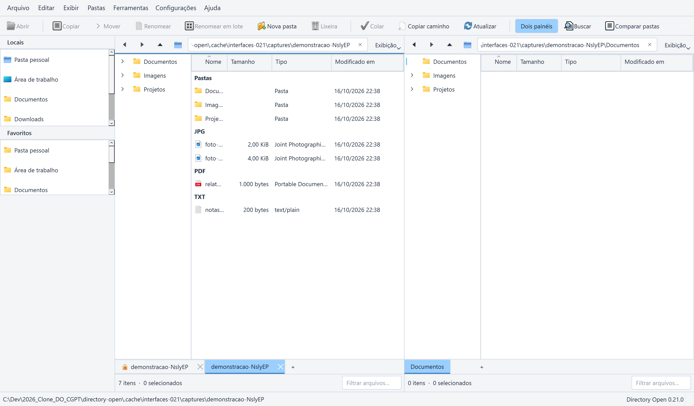

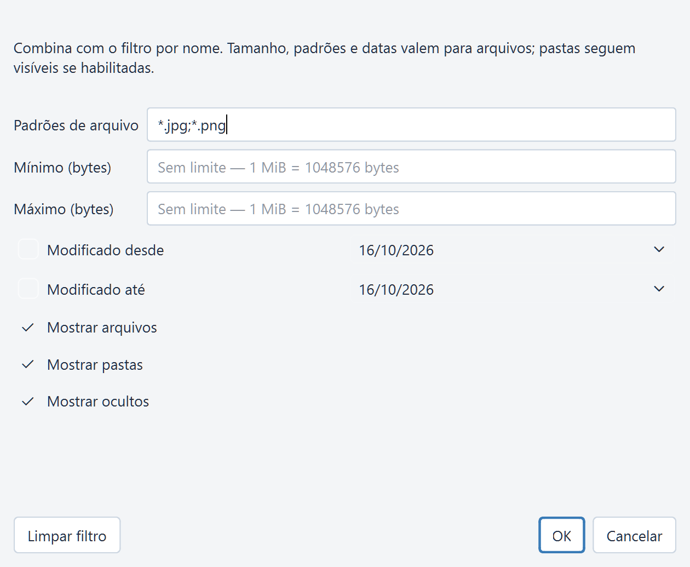

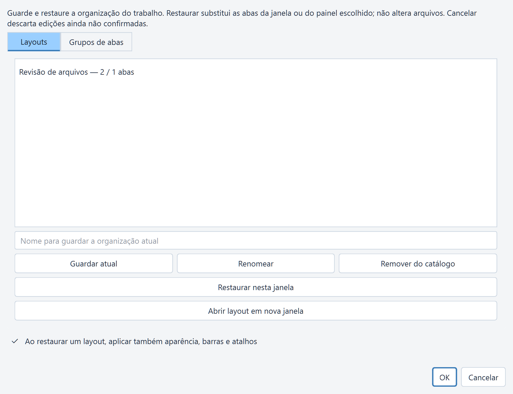

## Capturas da implementação própria

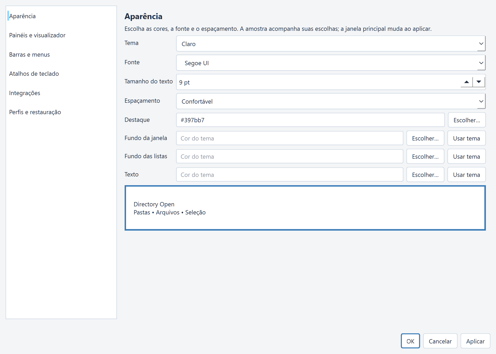

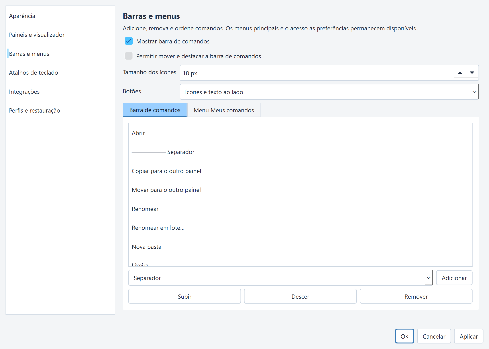

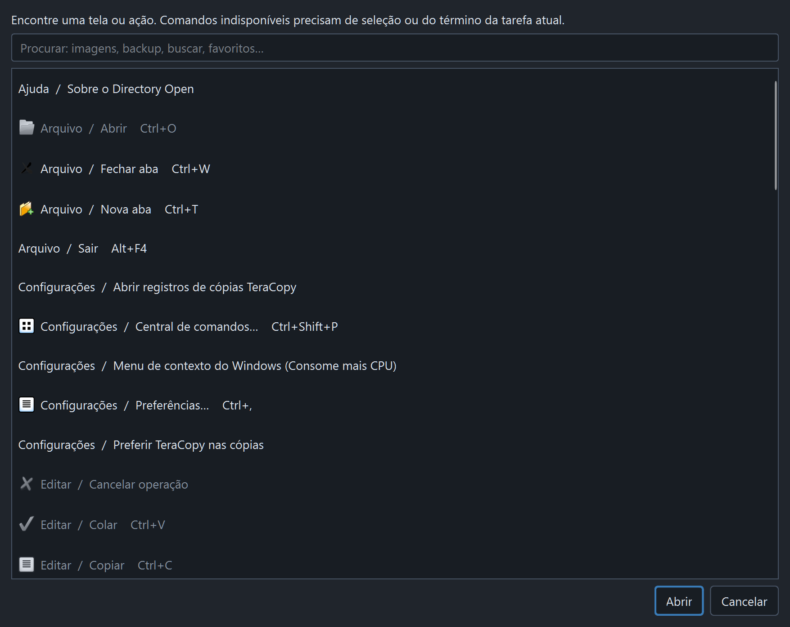

## Personalização avançada na 0.21

**Configurações → Personalização avançada (Ctrl+Alt+,)** organiza seis páginas:
barras adicionais nomeadas, menus, cores/fontes por componente, idioma, ícones e
lançadores. Editar é local ao diálogo; **OK** aplica e **Cancelar** descarta.
As Preferências continuam responsáveis pela barra principal e atalhos locais.

Até 16 barras e 32 lançadores; sete menus principais e três contextos próprios.
Configurações conserva Preferências, Central e Personalização mesmo se seu menu
personalizado ficar vazio. Os menus da árvore/abas usam comandos vinculados ao
item clicado. Ações do Shell continuam sob controle dos programas instalados.
Desmarcar Personalizar este menu restaura sua composição original.

Ícones PNG/ICO/JPEG: até 8 MiB, dimensão até 2048 pixels e imagem retida de até
64 pixels. Ausência/erro conserva o padrão. Cores e tamanho de texto podem ser
definidos para listas, árvores, menus, barras, abas e visualizador. Animações de
árvores/painéis são opcionais e indicam o custo de CPU. **Idioma** aceita pacote
Qt `.qm` até 1 MiB preparado para o DirOpen; vale na próxima execução para todo
o processo. Falha/texto não traduzido mantém português. Não há tradução completa
para inglês incluída; a fixture do teste demonstra o carregamento real.

Lançadores chamam um `.exe` com argumentos separados; não interpretam uma linha
de shell. `{file}`, `{folder}` e `{selection}` são argumentos inteiros. Até 256
itens por chamada e orçamento conservador da linha Windows. A prévia informa
programa, pasta e argumentos, com **Cancelar** como padrão. Após confirmar, o
programa externo tem os acessos normais do usuário e controla alterações,
progresso/cancelamento e resultado. Encaminhamento não é conclusão. Importar
perfil/layout nunca executa um comando.

**Layouts e grupos de abas → Aplicar somente aparência e conjunto de barras**
usa o mesmo catálogo, mantendo as pastas abertas. As barras são criadas antes
de restaurar sua posição; visibilidade é guardada na sessão.

**Configurações → Atalhos globais** permite guardar definições e ativá-las
explicitamente nesta execução. Reinício/importação permanecem inativos. Até 32
por janela: duas/três teclas entre Ctrl/Alt/Shift com A–Z, número ou F1–F11;
Windows/F12 e combinações simples ficam fora deste contrato. Windows registra
as combinações; falha conserva as ativas anteriores. Não há repetição por tecla
pressionada, execução durante modal/menu, nem alteração do registro do sistema.
Fechar a janela libera os registros; falha de limpeza conserva o recurso até
nova tentativa/destruição da janela proprietária. Documentação do contrato:
[RegisterHotKey](https://learn.microsoft.com/en-us/windows/win32/api/winuser/nf-winuser-registerhotkey).

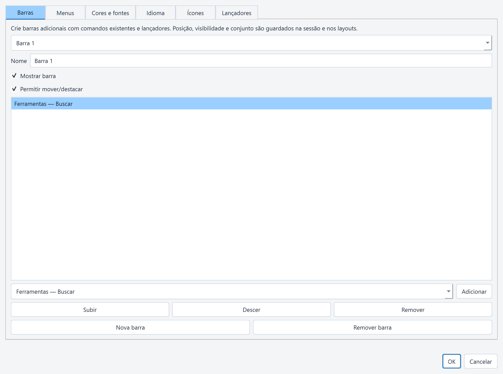
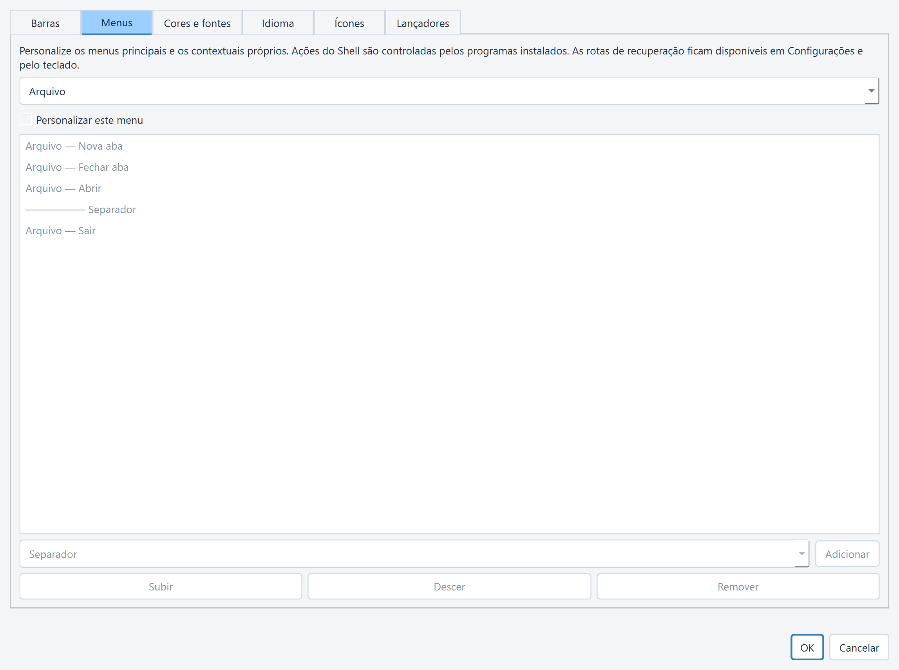
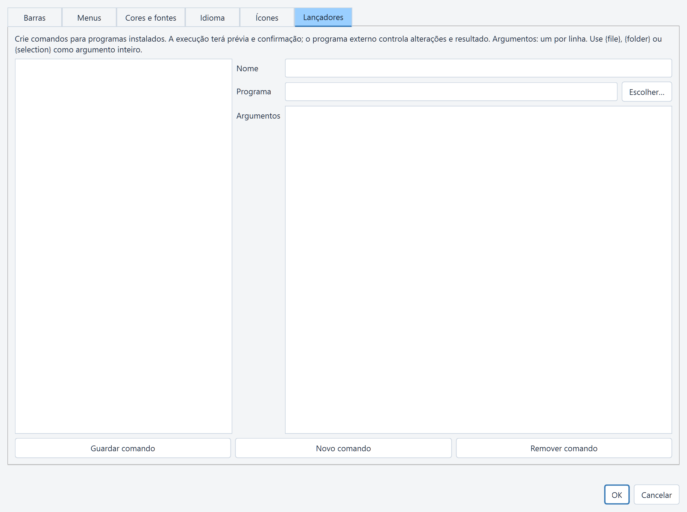

## Visualizador, classificações e triagem na 0.21

**Configurações → Preferências do visualizador**, ou o botão Preferências na
prévia, ajusta fonte/tamanho de texto, quebra de linhas, codificação inicial,
ajuste/suavização de imagens e prévia até1536/2048/4096pixels. As opções mais
custosas indicam CPU. Prévia e janela ampliada compartilham as escolhas, guardadas
na sessão, perfis e layouts. Permanecem os limites de arquivo64MiB e texto1MiB.

**Ferramentas → Classificar seleção** abre até256arquivos/pastas. **Triar imagens**
usa a seleção ou considera os primeiros256itens visíveis da pasta, filtrando as
extensões de imagem documentadas; o decodificador instalado decide o suporte real.
Lista, prévia e Anterior/Próximo permitem revisar. Etiqueta, cor, status,0–5estrelas,
até32tags de64caracteres e descrição de4096caracteres pertencem ao DirOpen. Não
escrevem EXIF, ADS ou conteúdo. As cores/classificações são exibidas nessa tela;
não há novas colunas/cores automáticas na lista principal nesta etapa.

Campos marcados substituem os valores dos itens selecionados; campos desmarcados
são preservados. Edição é preparada ao navegar e só persiste em **Guardar
classificações preparadas**. Cancelar descarta o que não foi guardado. Marcas
**Manter/Revisar/Descartar** podem avançar à imagem seguinte; Descartar é somente
um status, não exclui nem move. O visualizador ampliado e suas preferências também
funcionam na triagem.

O catálogo fica ao lado da sessão, com sufixo `.annotations.json`; limite10000
registros/8MiB, bloqueio, comparação de notas antes de mesclar, publicação atômica
e backup `.bak`. Chave de volume/ID/data de criação, confirmada pelo Windows:
renomeação no mesmo volume conserva as notas; cópia/substituição de caminho
recebe identidade nova. Sem identidade estável, links/junções ou item inacessível
não são classificados. Hardlinks repetidos exigem escolher uma ocorrência.
Catálogo inválido/versão não suportada é preservado e recusa gravação. Cancelar
aguarda o trabalhador; publicação já confirmada é reportada como salva.
**Sem sessão**, o catálogo existe apenas na memória da janela do DirOpen.
As classificações não acompanham automaticamente cópias, outros computadores ou
mudança de volume; isso exigiria exportação/migração explícita.

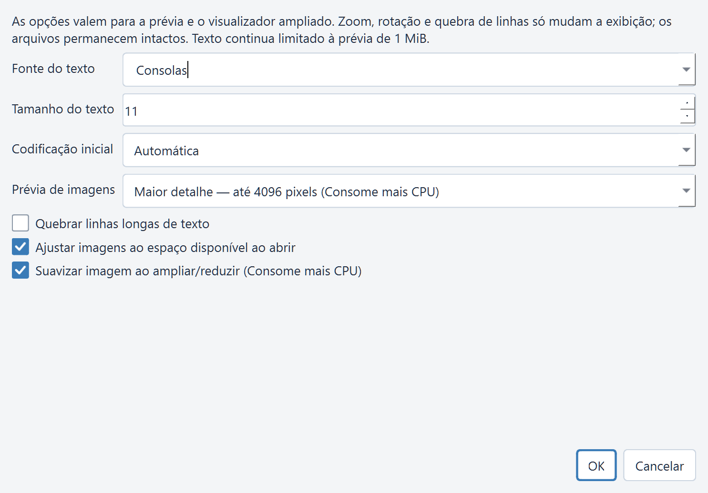
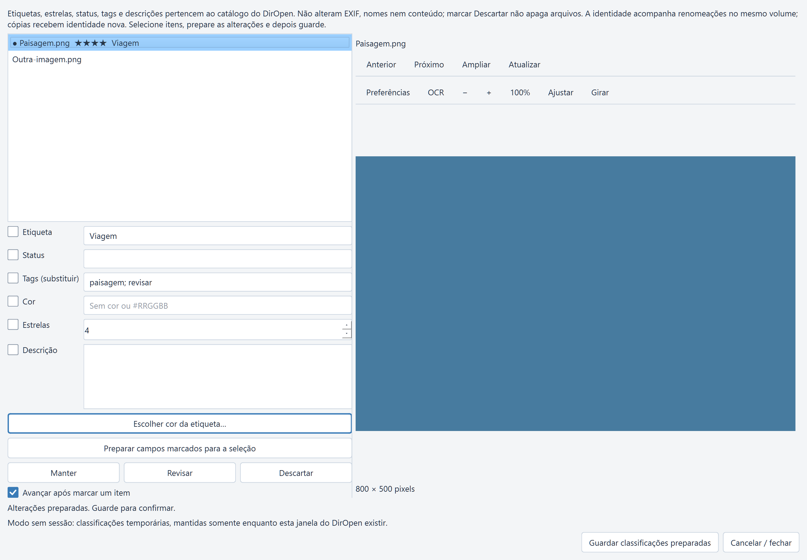

## Documentos e OCR na 0.21

A prévia reconhece DOCX, XLSX, PPTX, ODT, ODS e ODP. O 7-Zip instalado lê
somente as partes XML de um snapshot temporário; o DirOpen apresenta texto
simples, pesquisável e copiável. Não executa macros, fórmulas, objetos ou
relações externas. Word mostra parágrafos principais; apresentações mostram
slides em ordem numérica das partes; planilhas incluem nomes/estado oculto,
células e fórmulas com o valor em cache disponível. Formatação de datas/números,
imagens, comentários, disposição de página e formatos antigos DOC/XLS/PPT não
têm cobertura. Documentos protegidos continuam no aplicativo associado.

Arquivo até 64 MiB, XML agregado até 8 MiB e texto até 512 mil caracteres;
limites adicionais de 200 slides, 100 planilhas e 10 mil células por planilha.
Prévia incompleta é identificada. Temporários próprios são removidos após a
ferramenta encerrar; uma falha de limpeza informa o caminho preservado.

**Ferramentas → OCR da prévia**, ou **OCR** no visualizador/triagem, reconhece
somente a imagem ou página raster atualmente exibida. Usa Windows.Media.Ocr e
os idiomas já instalados; não instala pacotes nem envia imagens a um serviço.
É possível escolher o idioma, cancelar e copiar o texto. A imagem pode ter sido
reduzida pela prévia; o reconhecimento limita a dimensão a 3200 pixels ou ao
limite menor informado pelo Windows. Não processa automaticamente todas as
páginas de um PDF. Confira o texto com a imagem antes de usá-lo.

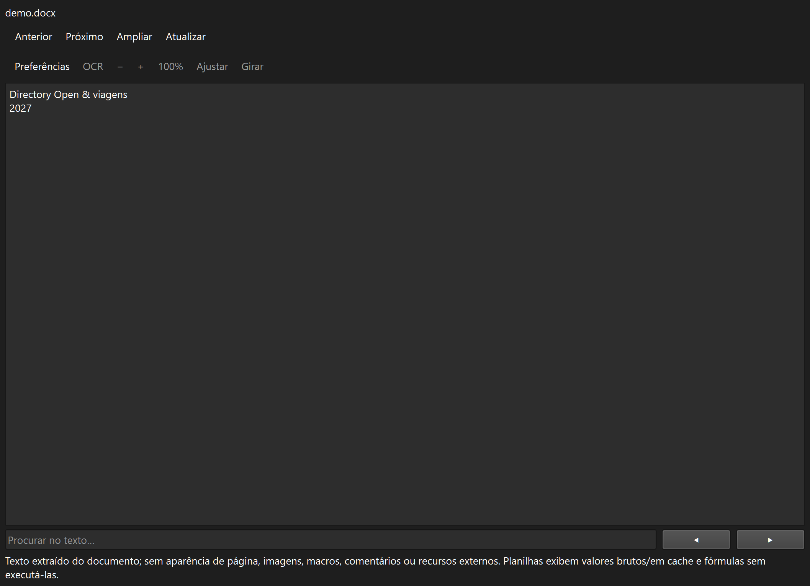
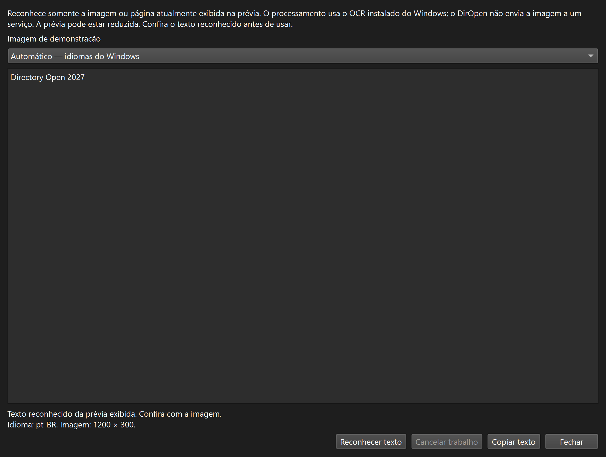

## Ferramentas especializadas, contas e compactados na 0.21

**Ferramentas → Duplicador especializado** permite escolher a instalação Python
já configurada. O DirOpen abre seu `pythonw.exe` com o módulo instalado, após
confirmação; não instala dependências nem inicia análise/exclusão. Mostra até
256 locais sugeridos / 64 mil caracteres, copiáveis para o clipboard. A versão
verificada do duplicador é 0.4.1 e não recebe seleção pela linha de comando:
adicione as pastas na janela dele. O caminho da instalação fica na sessão;
catálogos, resultados e critérios continuam pertencendo ao duplicador.

Em **Armazenamento remoto → Configurar / autorizar contas**, escolha o rclone e
um arquivo de configuração em pasta existente. Após confirmação, um arquivo
normal existente de até 16 MiB recebe backup exclusivo `.diropen-UUID.bak` ao
lado dele, pela cópia nativa do Windows; falha impede a abertura do assistente.
O conteúdo não é interpretado pelo DirOpen. Proteja esse backup como o original,
pois também pode conter credenciais. O rclone conduz a configuração em console
próprio e pode abrir o navegador para autorizar o serviço. Senhas/tokens não
entram nos argumentos ou na sessão do DirOpen. Volte e liste novamente as
conexões; iniciar o assistente não comprova que uma conta foi autorizada.
O teste automatizado utiliza somente um backend local fictício; não certifica
serviços, OAuth, chaves ou certificados de contas reais.

**Abrir compactado** também lista, testa e extrai RAR em arquivo único, incluindo
RAR5 sólido. Mantém a extração por fluxos individuais para uma pasta nova,
revalidação, nomes Windows seguros e marca de origem. Assinatura/cabeçalho RAR
determinam o decodificador; cabeçalhos criptografados, SFX, volumes, links,
fluxos alternativos e dados de segurança não cobertos são recusados.
ZIP/7z continuam disponíveis para criação; RAR é somente leitura.

**Opções no 7-Zip** abre o `7zFM.exe` instalado junto ao motor. Para criação,
abre a pasta de origem; selecione os itens nessa janela. Para leitura, abre o
compactado escolhido. Senhas, volumes, edição interna e configurações adicionais
dependem da ferramenta externa. Ela controla alterações/confirmações/cancelamento;
o DirOpen informa somente a abertura e exige nova listagem ao voltar.

## Receitas de renomeação na 0.21

Em **Renomear em lote → Receita de etapas**, componha até 16 etapas ordenadas:
prefixo, sufixo, substituição literal com opção de maiúsculas, recorte por posição
e quantidade, minúsculas, maiúsculas e retirada de espaços nas pontas. Atualize,
remova ou mova etapas e confira o resultado em um nome de exemplo. O recorte
conta caracteres Unicode, preservando pares de caracteres como emojis.
Cada etapa deve produzir até 255 unidades UTF-16; o nome final também passa
pela validação de nomes Windows e conflitos do lote.

As etapas atuam depois da substituição literal anterior e antes de inserir
`{name}` no modelo. A extensão preservada entra ao final. Se o modelo não usar
`{name}`, as etapas não alteram o nome. **OK** prepara a receita no diálogo de
lote; ainda é necessário gerar outra prévia e marcar a confirmação para aplicar.
Cancelar o editor descarta suas alterações. O motor de renomeação, a revalidação
e o histórico/desfazer existentes continuam responsáveis pela gravação.

É possível guardar/importar receitas nomeadas em JSON próprio de até 16 KiB,
com versão, validação estrita, gravação atômica e backup `.bak` ao substituir.
Salvar novamente conteúdo idêntico preserva o backup. Importação não executa
etapas nem renomeia arquivos. Essas macros são sequências de transformações;
não gravam teclas globais nem executam código arbitrário ou expressões regulares.

## Fila própria de operações

**Editar → Fila de operações (Ctrl+Alt+Q)** prepara a seleção do painel ativo.
Escolha copiar/mover, destino e motor e use **Adicionar e revisar…** para confirmar
cada tarefa. A fila começa pausada: **Iniciar / continuar** executa uma por vez.
É possível ordenar/remover pendentes, pausar as próximas e cancelar a atual.
Falhas, cancelamento, resultado parcial ou delegação pausam as próximas tarefas.

Até 32 pendentes, limitados a 8 MiB, e histórico de até 32 resultados com alvo de
8 MiB. O último relatório completo é preservado mesmo se sozinho exceder esse
alvo; as origens por tarefa e os caminhos continuam limitados.
Origem/destino são revalidados; conteúdo de pastas é avaliado na execução. Uma
operação avulsa não concorre com a fila. Fechar aguarda cancelamento e pede
confirmação para descartar pendentes; não há repetição automática após reinício.
Uma cópia TeraCopy continua externa: concluir a janela externa não informa o
resultado ao DirOpen. Confira-a e retome explicitamente a fila quando adequado.

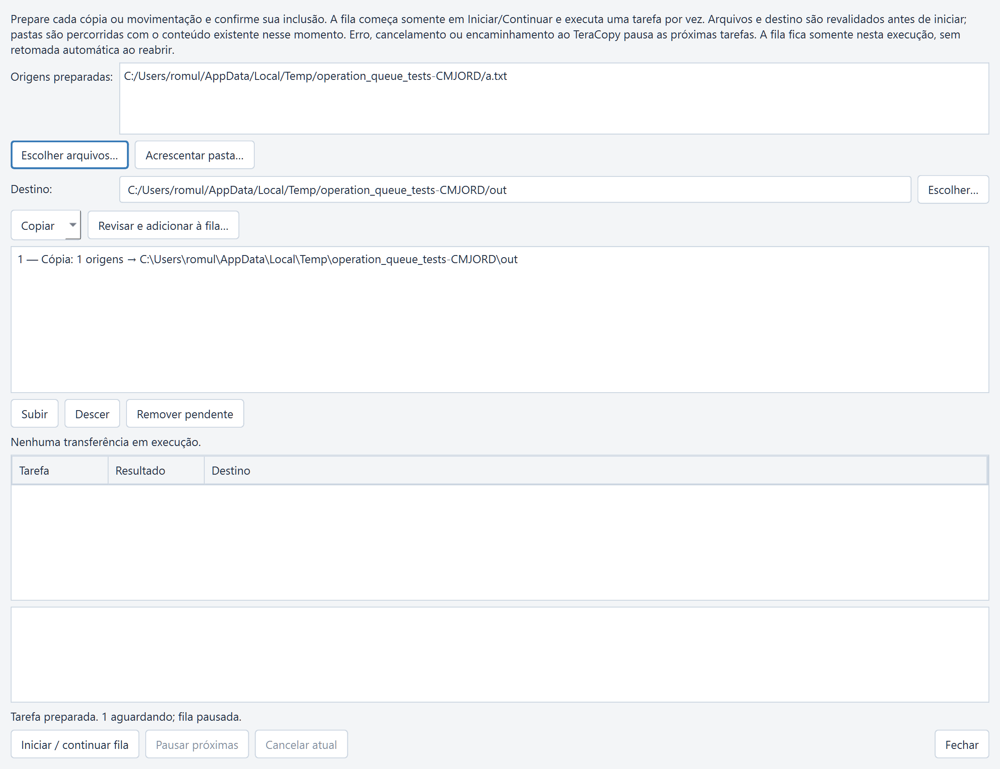

## Sincronização por cópia

Em **Ferramentas → Comparar pastas**, conclua a comparação e selecione as linhas
para **Preparar sincronização…**; sem seleção usa as linhas visíveis. Escolha
esquerda → direita ou direita → esquerda. O padrão copia somente faltantes.
Incluir arquivos diferentes exige política explícita: manter as duas versões ou
perguntar no Windows. Conflitos de tipos são impedimentos.

Revise os destinos, gere outra prévia após editar opções/seleção e marque a
confirmação para aplicar. Dicas das linhas exibem caminhos completos e tamanhos
conferidos quando disponíveis. Raízes, origens, destinos e identidade/presença
dos alvos são revalidados antes da primeira cópia e de cada transferência.
Até 5.000 linhas e 256 origens de transferência; uma pasta faltante cobre seus
descendentes sem duplicar a cópia. Conteúdo da pasta é lido na execução.

Não propaga exclusões, não resolve alterações bidirecionais automaticamente e
preserva cópias já concluídas em interrupção. Outro plano exige nova comparação.
O motor de aplicação desta tela é o Windows; backup versionado continua no restic.

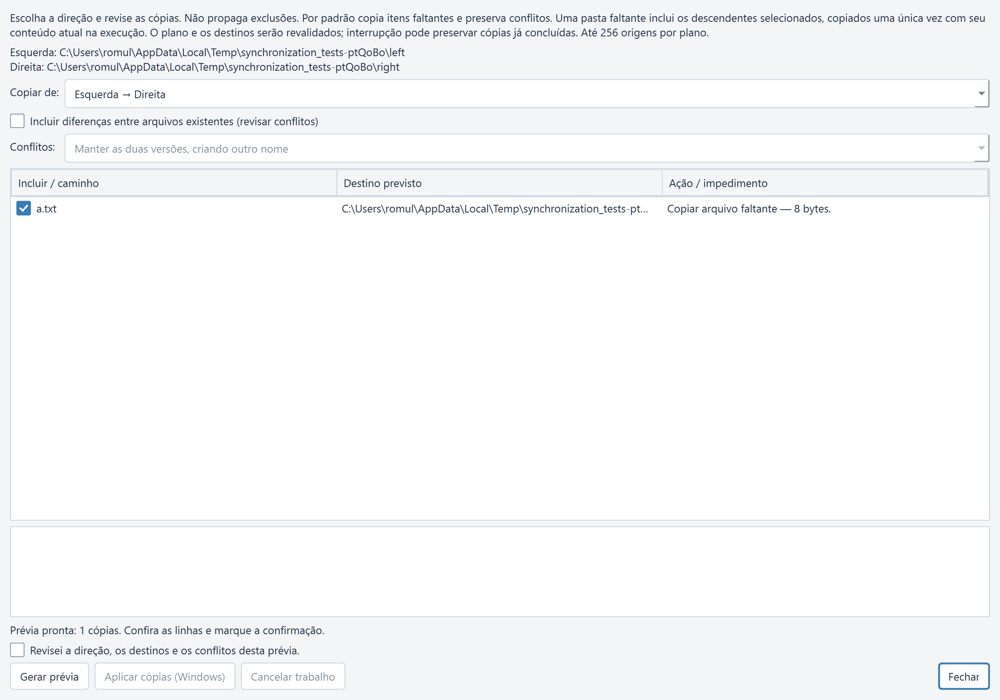

## Scripts e formulários

**Ferramentas → Scripts e formulários** aceita um manifesto JSON próprio
`DirectoryOpen.Script` v1, até 32 KiB, e código Python UTF-8 até 512 KiB, na mesma
pasta do manifesto. Até 16 campos: texto, inteiro, opção booleana, lista de
escolhas, arquivo e pasta. Há exemplo em `examples/scripts/listagem.json`.

Carregar mostra campos, código e SHA-256 sem executá-lo. Configure o Python
instalado, confira pasta/seleção/código, autorize essa execução e confirme.
Editar entradas retira a autorização. O programa recebe JSON no stdin com
contrato `DirectoryOpen.ScriptInput` v1, pasta, seleção e valores tipados.
Até 256 locais/2 MiB de entrada; nomes de campos e propriedades são validados.

Cada execução usa uma cópia privada imutável do código aprovado, `-I -B -u
-X utf8`, e processo/família supervisionados. Cancelar aguarda o encerramento;
o script possui permissões completas do usuário para arquivos, programas e rede,
**sem sandbox**. Alterações e saídas já criadas são preservadas. Código zero é
recibo do processo, não prova de integridade das alterações feitas pelo script.

Só os caminhos de Python/manifesto pertencem à sessão. Valores do formulário,
código, saída e consentimento não são persistidos; não há autorun ao reabrir ou
importar. Arquivos criados pelo script ao lado da cópia privada são preservados
e o caminho é informado; a limpeza só remove código próprio por identidade.

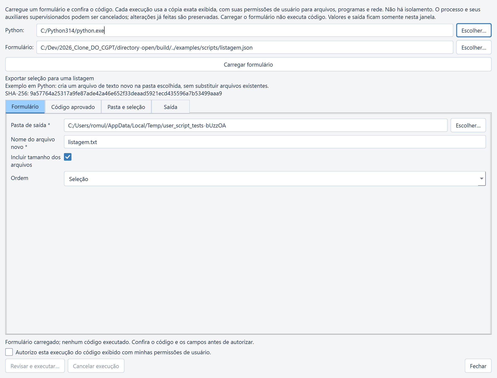

## Associações e abertura de pastas

**Configurações → Associações e abertura de pastas** consulta o aplicativo de
uma extensão e abre a tela oficial **Aplicativos padrão** do Windows. Pesquise a
extensão nessa tela e faça a escolha; depois atualize a consulta no DirOpen.
O aplicativo não força nem reescreve o hash de `UserChoice`.

A página **Pastas físicas** oferece encaminhar a ação **Abrir** de diretórios
para esta cópia do DirOpen. É uma escolha explícita por usuário. O executável
deve permanecer no mesmo local enquanto ativo. Win+E, pastas virtuais e diálogos
de seleção continuam sob controle do Windows.

Antes de alterar os valores de `HKCU\Software\Classes\Directory\shell`,
guarda tipos, bytes, ausências anteriores e registro de recuperação em
`HKCU\Software\DirectoryOpen\FolderIntegration`. O backup é confirmado antes
das etapas de abertura. Não depende de transações TxR, recusadas por este Windows.
Interrupção pode deixar alteração parcial: **Atualizar estado → Reverter
alteração incompleta** recupera o estado anterior à tentativa, após revisão.
Se ele já era ativo, use depois **Restaurar configuração anterior** para desativar.

Restauração confere os valores atuais; alterações externas são preservadas e
impedem reversão automática. Chaves de estrutura e backups ficam preservados.
A interface não ativa nada ao abrir, importar ou restaurar um layout. Os testes
usam registro isolado, inclusive uma chamada real do Shell a esse comando;
as associações pessoais não foram alteradas. O comportamento global de todos
os caminhos de abertura do Explorer não está certificado.

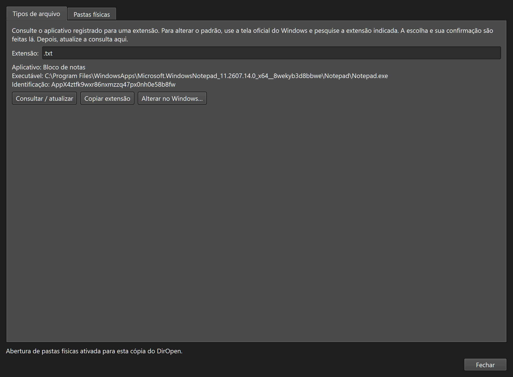

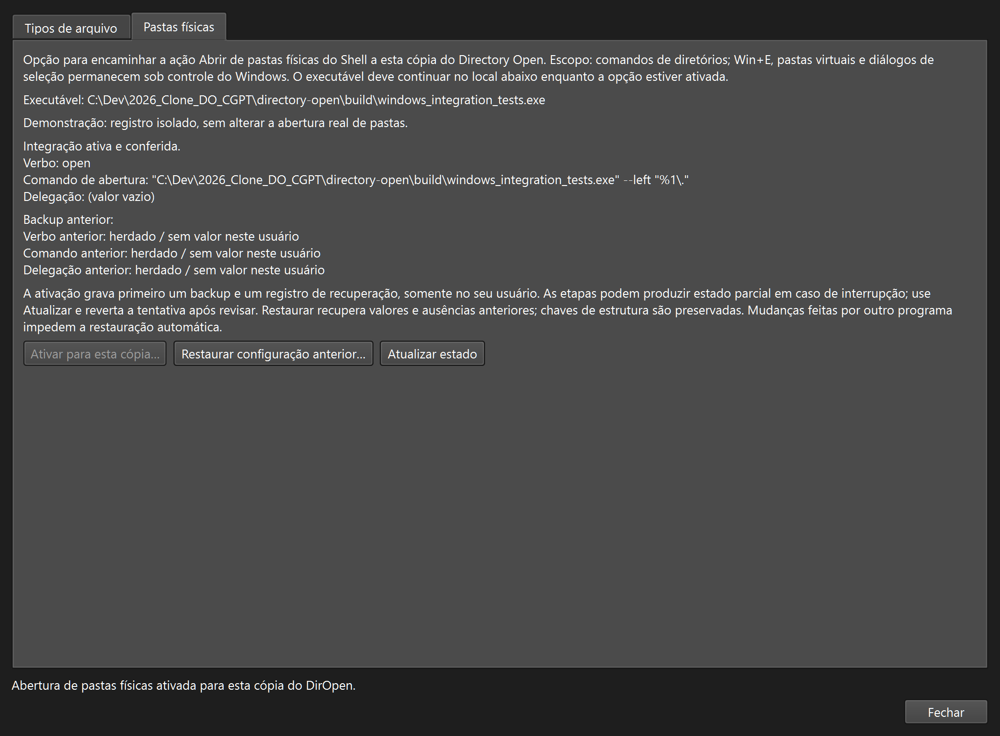

## Relatórios e listagens

**Ferramentas → Calcular tamanho das pastas…** oferece coleta opcional de
listagem, exportação CSV/TXT e **Prévia / imprimir…** após concluir/cancelar.
A prévia tem navegação de páginas e **Salvar PDF novo…**. Cálculo e listagem
possuem coberturas distintas; detalhes não coletados não são reconstruídos.
Veja políticas, formato e limites no [manual](USO.md#relatórios-csvtxt-e-impressão-p16b-024-local).
