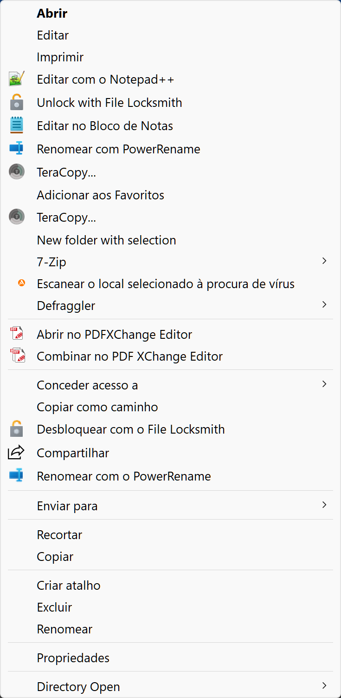
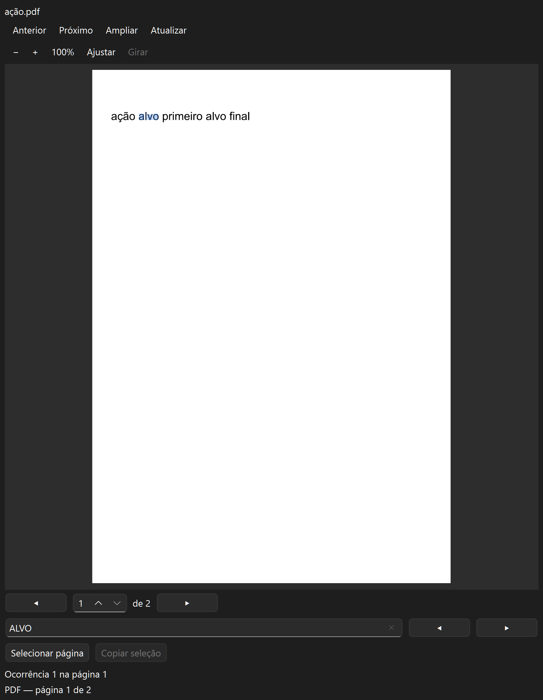
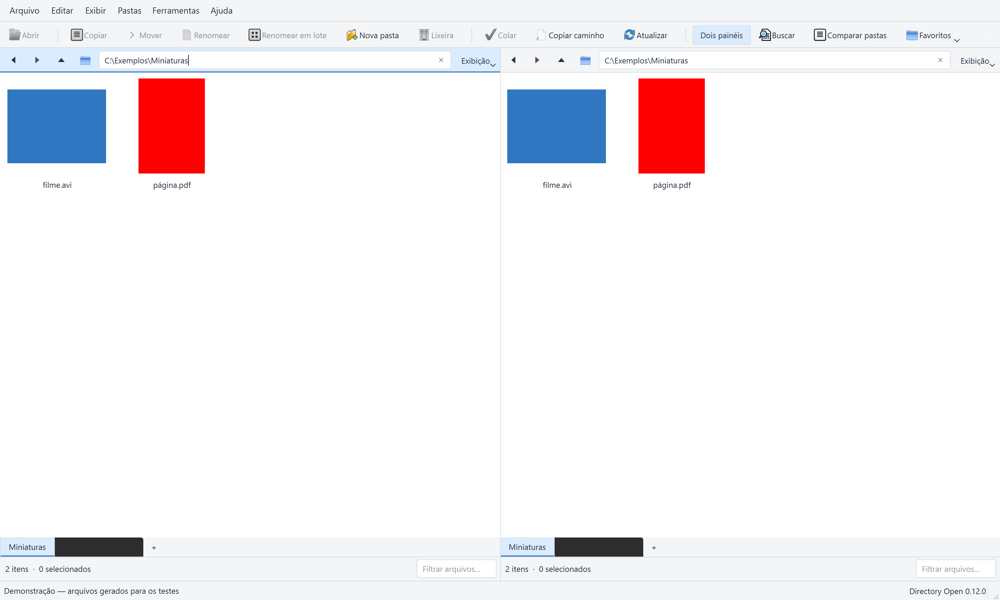
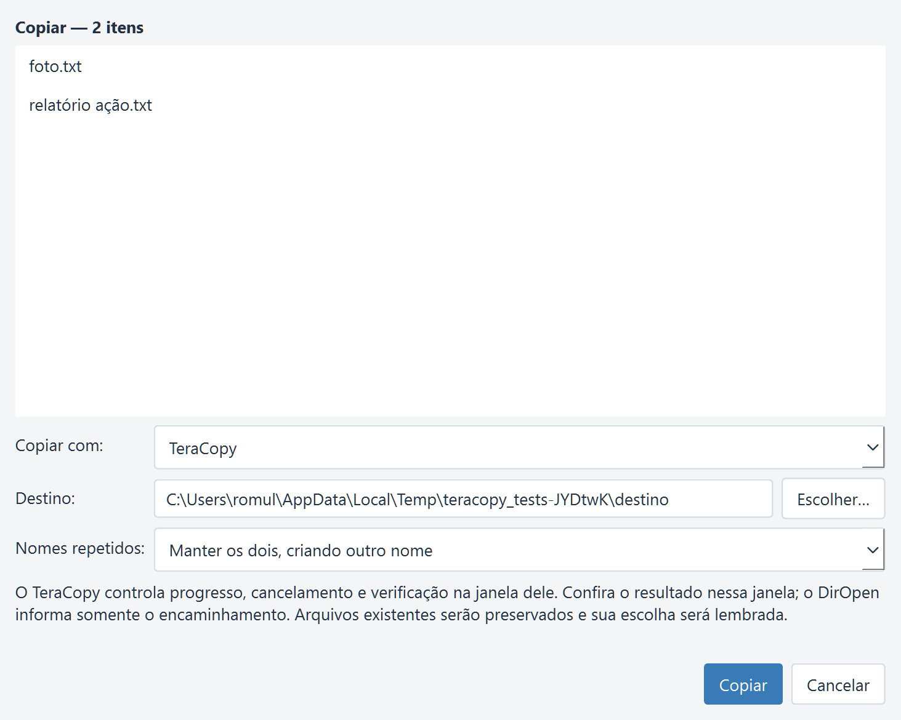
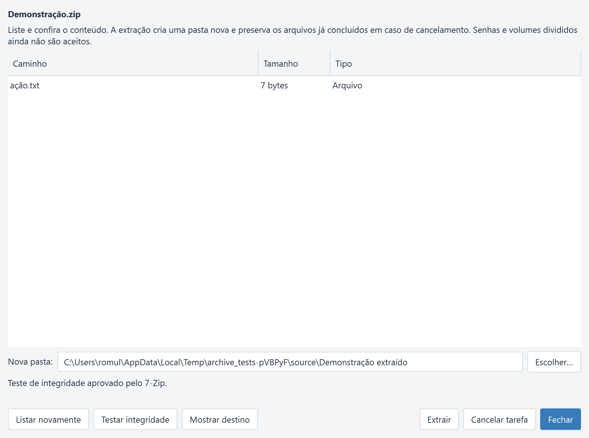
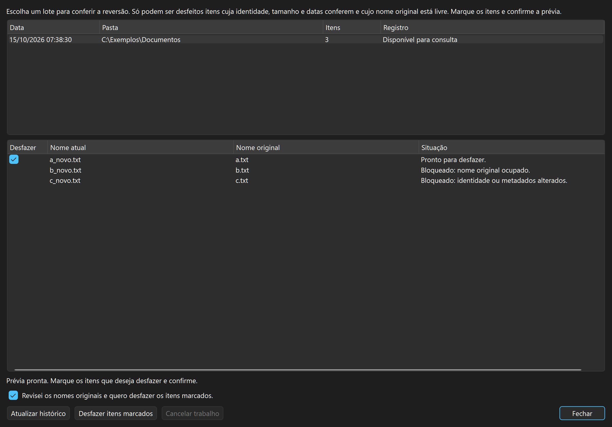

# Manual do Directory Open 0.22

## Personalizar e encontrar comandos

Na 0.20, abra **Configurações → Preferências (Ctrl+,)** para ajustar aparência,
painéis, barra, menu pessoal, atalhos e integrações. **Aplicar** mantém a janela
aberta; **OK** aplica e fecha; **Cancelar** descarta somente o ainda não aplicado.
As escolhas são guardadas na sessão ao encerrar normalmente, com backup.
**Ctrl+Shift+P** abre a central pesquisável para acessar telas e ações existentes.
O [inventário de interfaces](INTERFACES.md) detalha opções, perfis e pendências.

## Metadados e conversão de imagens, áudio e vídeo

Selecione até **200 arquivos** no painel e abra um dos novos comandos em
**Ferramentas**. Cada janela permite escolher os executáveis opcionais e uma
**pasta de saída que ainda não exista**. Gere a prévia, selecione linhas para ver
detalhes e confirme a execução. Alterar as opções invalida a prévia. As ferramentas
são supervisionadas em segundo plano; Fechar/Cancelar aguarda seu encerramento.

| Comando | Operação | Limites iniciais |
|---|---|---|
| Metadados — ExifTool | Sem alterações cadastradas, Consultar mostra até 256 propriedades por arquivo. Para editar, escolha campo, valor e Acrescentar alteração; repita para outros campos. A prévia mostra valor atual → proposto. Salvar cópias grava e relê os valores. | 12 campos EXIF/IPTC/XMP, conforme suporte do formato. Datas `AAAA:MM:DD HH:MM:SS` sem fuso. Campos de lista recebem um único valor e substituem a lista. Sem remoção de campos ou edição direta do original. |
| Converter imagens — ImageMagick | Escolha PNG/JPEG/WebP/TIFF, largura/altura máximas, rotação e qualidade. Livre/zero deixa dimensão livre; mantém proporção sem ampliar, depois gira no sentido horário. Prévia visual do primeiro arquivo. | Entradas JPEG/PNG/WebP/TIFF raster até 100 megapixels. Apenas primeira página/quadro. Aplica orientação EXIF; JPEG converte transparência em branco. Conversão pode perder qualidade, perfis e metadados; sem garantia de preservação integral. |
| Áudio e vídeo — FFmpeg/ffprobe | A prévia consulta formato, duração, tamanho, taxa e codecs/fluxos. MP4 converte primeiro vídeo e primeiro áudio opcional; MP3/WAV/FLAC extraem o primeiro áudio. | MP4 H.264/AAC de 8 bits; vídeos HDR reconhecidos são recusados. MP3 192 kbit/s, WAV PCM 16 bits, FLAC. Sem legendas/anexos, seleção de faixas, HDR, playlists/rede ou perfis avançados. O visualizador existente continua disponível. |

Nenhum original é substituído. Nomes de saída repetidos são recusados; não mescla
pastas existentes. Antes de publicar, confere a origem da prévia, os valores de
metadados ou a validade da imagem/mídia. Áudio/vídeo passa por decodificação completa,
que acrescenta tempo à conversão. A marca de origem do Windows é mantida nas saídas.
Cancelar preserva os arquivos já concluídos; um erro pode deixar a pasta de saída
parcial. Qualquer limpeza pendente informa seu caminho, sem remover material externo.

Ferramentas opcionais verificadas localmente: **ExifTool 13.59**, **ImageMagick
7.1.2-34 Q16 x64** e **FFmpeg/ffprobe 9.0.2** (build Windows do fornecedor indicado
pelo FFmpeg). Executáveis ficam em `tools/` neste ambiente, com seus arquivos de
suporte; não são instalados globalmente, baixados pelo build ou incluídos no pacote.
A sessão salva apenas seus caminhos. UNC, outros discos/Windows, RAW, listas com
vários valores, todos os codecs e metadados/ACLs completos ainda exigem validação.

Contratos: [ExifTool](https://exiftool.org/exiftool_pod.html),
[ImageMagick](https://imagemagick.org/command-line-options/),
[FFmpeg](https://ffmpeg.org/ffmpeg.html) e [ffprobe](https://ffmpeg.org/ffprobe.html).

## Busca de conteúdo, backups e armazenamento remoto

Em **Ferramentas**, cada uma das três janelas permite escolher o executável da
ferramenta. O DirOpen procura em `tools` junto ao aplicativo (ou junto à pasta
de compilação), em Program Files e no PATH. Um caminho configurado indisponível
não é trocado silenciosamente. As ferramentas são opcionais e não são instaladas
pelo build. Use distribuições oficiais, preservando seus avisos e licenças.

| Comando | Como usar | Limites desta etapa |
|---|---|---|
| Buscar conteúdo — ripgrep, Ctrl+Alt+F | Escolha pasta/texto e Buscar. Ative expressão regular se necessário. Duplo clique abre o arquivo; outro botão abre sua pasta em aba. | Por padrão respeita regras de exclusão e omite ocultos; opções permitem incluí-los. Não segue links. Binários, arquivos >64 MiB e PDF/Office sem extração não têm cobertura completa. Até 10 mil linhas, trechos de 1.024 caracteres; limite/erro = resultado parcial. |
| Backups com versões — restic | Selecione arquivos/pastas no painel. Digite um repositório local novo, senha e Inicializar; confirme a senha. Backup da seleção cria uma versão. Liste versões, selecione uma e restaure em pasta nova. | Senha não é salva; guarde-a. Origens devem estar na mesma pasta. Raízes relativas evitam capturar os ancestrais do sistema. Restaura a versão completa e verifica conteúdo, preservando a origem. Repositório remoto, agendamento, retenção e seleção interna ainda pendentes. |
| Armazenamento remoto — rclone | Selecione um rclone.conf já autorizado. Liste conexões; duplo clique preenche o local. Abra e navegue pelas pastas. Escolha Enviar/Receber, pasta local e local remoto; execute a prévia e depois Copiar. | Copia **o conteúdo** da pasta, sem acrescentar seu nome. Diferenças existentes impedem substituição; não exclui destinos. A prévia é indicativa e os locais são relidos ao executar. OAuth/configuração de contas e configurações criptografadas/interativas ficam fora desta etapa. |

Durante uma tarefa, **Cancelar tarefa** e Fechar solicitam o encerramento e aguardam
a ferramenta e seus auxiliares. Itens já gravados são preservados. Diagnósticos e
resultados parciais aparecem na janela; não há repetição automática em outro motor.
Catálogos têm limite de 8 MiB/10 mil itens, linhas de protocolo até 1 MiB e o trecho
final de diagnóstico até 64 KiB. O cancelamento do restic pode deixar um lock;
confira as tarefas ativas antes de qualquer manutenção manual pelo próprio restic.

A sessão guarda apenas executáveis, caminho do rclone.conf e repositório local;
não guarda senha ou cópia das credenciais. O próprio rclone pode renovar tokens no
arquivo autorizado. Não forneça credenciais em nomes de conexão/endereço; use
`nome:pasta`. A integração foi conferida com restic 0.19.1, rclone 1.75.2 e ripgrep
15.2.0 em dados de demonstração. Nuvens reais, rede, ACLs/ADS e todos os formatos de
repositório ainda precisam de validação específica. Erros de metadados na restauração
são parciais, mesmo quando o conteúdo foi recuperado.

Contratos oficiais: [restic JSON e códigos de saída](https://restic.readthedocs.io/en/stable/075_scripting.html),
[restauração](https://restic.readthedocs.io/en/stable/050_restore.html),
[rclone copy](https://rclone.org/commands/rclone_copy/),
[rclone lsjson](https://rclone.org/commands/rclone_lsjson/) e
[guia do ripgrep](https://github.com/BurntSushi/ripgrep/blob/master/GUIDE.md).

## Recursos e atalhos

- Dois painéis com listas reais, ordenação e seleção múltipla.
- Árvore de pastas e atalhos para locais comuns.
- Abas com histórico independente e filtros por nome.
- Voltar, avançar, pasta acima e endereço editável.
- Tema claro/escuro e alternância entre um ou dois painéis.
- Visualizador de imagens, texto, PDF, áudio e vídeo, com carregamento em segundo plano.
- Duplo clique em arquivo abre o programa padrão do Windows; em pasta navega.
  O botão Abrir e Ctrl+O usam a mesma abertura. Um clique seleciona para pré-visualização.
- Copiar caminho para a área de transferência.
- Criar ZIP/7z, listar conteúdo, testar integridade e extrair com o 7-Zip instalado.
- Copiar arquivos e pastas para o outro painel, com seleção múltipla,
  confirmação do destino, progresso e cancelamento pelo mecanismo do Windows.
- Perguntar em conflitos ou manter ambos com um nome gerado pelo Windows.
- Relatório por item: copiado, ignorado, cancelado, parcial, não iniciado ou erro.
- Mover arquivos e pastas entre painéis, com confirmação do destino e conflitos.
- Renomear um item por vez, incluindo nomes Unicode e mudanças de maiúsculas.
- Criar pastas no painel ativo, validando nomes e recusando colisões.
- Enviar itens à Lixeira do Windows após confirmação explícita.
- Recuperar abas, pastas, filtros, ordenação, painel ativo, tema e layout.
- Menu de contexto nativo do Windows nas listas, miniaturas e árvore lateral,
  com extensões instaladas e comandos próprios no submenu Directory Open.
- Copiar, recortar e colar arquivos pela área de transferência do Windows.
- Arrastar entre os painéis, com cópia padrão e movimentação com Shift.
- Busca por nome em subpastas, em segundo plano, com cancelamento e resultados em nova aba.
- Favoritos editáveis na barra e na lateral, guardados junto da sessão.
- Comparação de pastas por tamanho/data ou conteúdo, com subpastas e cancelamento.
- Exibição por pasta: detalhes, somente nomes ou miniaturas, com tamanho, colunas e ordenação compartilhados entre painéis.

Atalhos: Ctrl+T nova aba, Ctrl+W fechar aba, Ctrl+L endereço, Ctrl+F filtro,
Alt+Left voltar, Alt+Right avançar, Alt+Up pasta acima, F6 dois painéis,
F7 pré-visualização, F8 copiar seleção, Ctrl+M mover, F2 renomear,
Ctrl+Shift+N nova pasta, Delete enviar à Lixeira, Ctrl+O abrir e
Ctrl+Shift+C copiar caminho. Delete atua na lista de arquivos; em campos de
texto, continua editando normalmente.
Ctrl+C copia arquivos, Ctrl+X prepara o recorte e Ctrl+V cola no painel ativo.
Esses três atalhos só atuam em arquivos quando a lista tem o foco; nos campos
de texto, mantêm a edição normal. O botão Colar também está na barra de comandos.
Ctrl+Shift+F abre a busca recursiva; Ctrl+D adiciona a pasta atual aos favoritos.
Ctrl+Shift+K abre a comparação das pastas dos dois painéis. Ctrl+F2 abre a renomeação em lote.
Ctrl+Shift+R abre o histórico de renomeações.

## Menu do botão direito

Em **Configurações → Menu de contexto do Windows (Consome mais CPU)**, marque
para incluir as ações dos programas instalados ou desmarque para usar somente
o menu simples do Directory Open. A troca vale imediatamente para os painéis
e a árvore lateral. A opção começa ativada e é guardada junto da sessão ao fechar
normalmente; sessões antigas mantêm o menu do Windows até você alterar a escolha.

Clique com o botão direito em um arquivo ou pasta para abrir o menu clássico do
Windows, incluindo ações dos programas instalados que oferecem essa integração
(por exemplo, 7-Zip, PowerRename, Git e VLC). O conteúdo depende do tipo de item,
da seleção e das extensões disponíveis; não é uma lista fixa copiada da imagem.
Extensões exclusivas do menu compacto do Windows 11 ou que exigem serviços internos
do Explorer podem não aparecer ou não funcionar neste gerenciador.

Nas listas e miniaturas, clicar em um item já selecionado conserva a seleção
múltipla; clicar em outro seleciona esse item. O espaço vazio abre o menu da pasta
atual. **Shift+F10** ou a tecla de menu abre o menu para a seleção do painel.
Na árvore lateral, o alvo é a pasta clicada, sem mudar a pasta do painel.

O submenu **Directory Open** mantém abrir em nova aba, copiar/mover para o outro
painel, renomeação em lote e demais comandos próprios. Abrir, copiar, recortar,
colar, renomear, excluir, criar pasta e atualizar, quando identificados pelos verbos
padrão do Windows, são encaminhados às ações do aplicativo. Excluir continua
enviando à Lixeira com confirmação, mesmo com Shift; não há exclusão definitiva
nesse comando. Renomear mantém a confirmação. Abrir uma pasta navega no painel.
Copiar caminho, no submenu próprio, inclui todos os itens selecionados, um por linha.

As demais ações são delegadas ao Windows ou ao programa escolhido, que controla
sua janela, confirmações e alterações. Renomeações feitas por PowerRename ou por
outra extensão não entram no histórico de lotes do Directory Open. O aplicativo
libera a reprodução de mídia antes de delegar um comando. Arquivos são monitorados
pelo modelo; operações externas podem terminar depois que o menu fechar.

Se o Windows não fornecer o menu, os comandos próprios continuam disponíveis e o
motivo aparece na barra de status. Nenhuma extensão é instalada, e o registro,
as associações de pastas e o atalho Win+E não são alterados por esta integração.

## Visualizar arquivos

Selecione um arquivo e use **F7** para mostrar o painel. **F3** ou **Ampliar** abre
o mesmo visualizador numa janela maior; **F11** alterna tela cheia nessa janela.
**Esc** fecha a janela ampliada e retorna ao gerenciador. O painel também pode ser
movido para a parte inferior ou destacado. **Anterior/Próximo** percorrem os arquivos
visíveis na ordem da lista, respeitando o filtro e ignorando pastas.

**Imagens:** zoom, Ctrl+roda do mouse, 100%, ajuste ao painel e rotação da visualização.
A rotação não grava o arquivo. São aceitos os formatos reconhecidos pelos plugins Qt
distribuídos (PNG/JPEG verificados); imagens de vários quadros mostram o primeiro.
Imagens maiores podem usar uma prévia reduzida, identificada no rodapé; 100% representa
as dimensões originais, mas não recupera detalhes descartados da prévia reduzida.

**Texto:** leitura sem edição ou execução de HTML/scripts, procura anterior/próxima
com retorno ao início/fim e escolha de codificação. Automática reconhece BOM de
UTF-8/UTF-16/UTF-32 e tenta UTF-8; se inválido, oferece Windows-1252, indicado como
alternativa. Há escolhas explícitas de UTF-8, UTF-16 LE/BE, Windows-1252 e ISO-8859-1.
Sem BOM, UTF-16 precisa ser escolhido explicitamente em arquivos com extensão textual;
arquivos identificados como binários não são convertidos automaticamente.

**PDF:** páginas, zoom e ajuste com Qt PDF, incluído entre as dependências do pacote.
Não é necessário Adobe Reader. No visualizador com foco, **Ctrl+F** abre a pesquisa;
digite o texto e pressione Enter ou use as setas para a ocorrência anterior/próxima,
inclusive em outra página. A busca não diferencia maiúsculas e destaca a ocorrência.
Fora do visualizador, Ctrl+F continua a filtrar o painel de arquivos.

Arraste sobre o texto da página para selecionar. **Selecionar página** ou **Ctrl+A**
com foco na página seleciona seu texto; **Copiar seleção** ou **Ctrl+C** copia como
texto simples. A seleção aparece depois de soltar o mouse. As mesmas ferramentas
funcionam em F3/F11. Copiar texto não copia o PDF e não altera seu conteúdo.

A busca examina até 128 páginas por solicitação, a partir da página atual. Páginas
acima de 65.536 caracteres não são pesquisadas/selecionadas; seleção/geometria tem
limite de 4.096 regiões. Quando há limite, o aviso indica busca parcial: não prova
ausência no restante. Navegue manualmente para outra página para continuar. Não há
contagem total de ocorrências ou índice persistente do documento.
PDF admite até 10.000 páginas e 64 MiB. O texto disponível segue a camada textual
do arquivo; documentos digitalizados sem texto não usam OCR. Não há formulários,
links interativos ou entrada de senha. PDFs protegidos ou inválidos mostram um
aviso. Documentos Office ficam para outra etapa.

**Áudio e vídeo:** selecione um arquivo e use F7/F3. Clique em **Reproduzir**;
a seleção carrega a mídia sem iniciar som ou reprodução. O botão alterna para
**Pausar**. **Parar** retorna ao início. A barra de posição permite buscar com
mouse ou teclado quando o arquivo oferece busca; há tempo atual/duração, volume
e **Silenciar**. Volume/silenciamento permanecem enquanto o visualizador existe.
Anterior/Próximo continuam seguindo a ordem e o filtro do painel. Não há avanço
automático no fim da mídia.

F3/Ampliar reutiliza o mesmo reprodutor e F11 alterna tela cheia na janela ampliada;
fechar essa janela devolve o visualizador ao painel. Trocar de arquivo, ocultar o
painel ou fechar o aplicativo encerra a reprodução e libera o dispositivo aberto.
Mover, renomear, enviar à Lixeira e abrir o lote também encerram a mídia antes da
confirmação; se cancelar a operação, use **Atualizar** para carregar novamente.

A leitura é local, pelo Qt Multimedia, sem carregar o arquivo inteiro em memória.
Extensões candidatas: WAV, MP3, FLAC, OGG, OPUS, AAC, M4A, WMA, MP4, M4V, MOV,
MKV, WEBM, AVI, WMV, MPG/MPEG, TS e 3GP. A extensão não garante um codec: um arquivo
inválido ou sem decodificador mostra o erro no visualizador. WAV PCM e AVI/MJPEG
foram verificados com fixtures próprias, incluindo quadros efetivamente decodificados.
Não é uma declaração de suporte a todos os codecs desses contêineres. Não há
playlists, URLs de streaming, captura, gravação, conversão ou editor de mídia.
Nenhum pacote externo de codecs é instalado pelo aplicativo.

**Atualizar** no visualizador relê o arquivo; em PDF, retorna à primeira página.
A prévia representa uma leitura do arquivo, não um acompanhamento contínuo de edições
feitas por outros programas. Mudanças de seleção descartam resultados antigos e
mantêm apenas a solicitação mais recente. O cache de PDF é validado pelo SHA-256 do
conteúdo relido antes de reutilizar o documento analisado; não mantém o arquivo aberto.
A busca/seleção opera na mesma cópia já exibida, mesmo se o original mudar ou for
movido depois da leitura. Use Atualizar para ler a versão atual e limpar a seleção.

Limites desta etapa: imagens/PDF de até 64 MiB, imagens de origem até 128 megapixels,
bitmap de prévia até 4096×4096 e texto até 1 MiB (trechos maiores são indicados como
parciais). PDF pede páginas de até 1800×2400 pixels, considerando a escala de tela.
A memória interna dos decodificadores nativos pode variar. Uma operação nativa de
leitura/decodificação já em andamento precisa terminar antes do trabalhador encerrar;
o aplicativo aguarda no fechamento, sem abandonar threads ou arquivos.

O inicializador antigo `IniciarNavega.cmd` encaminha para `IniciarDirOpen.cmd` para
preservar atalhos. A sessão continua em `%LOCALAPPDATA%\Navega\session.json`, com
backup e proteção de concorrência; a troca de nome não move nem apaga preferências.
As variáveis de build `NAVEGA_*` existentes continuam válidas.

## Buscar e organizar favoritos

Clique em **Buscar** ou pressione **Ctrl+Shift+F**. A pasta inicial é a do painel
ativo. Digite parte do nome, sem distinção de maiúsculas, ou marque **Usar padrões**
para buscar, por exemplo, `*.pdf`. Ela examina nomes nesta pasta e nas subpastas;
não pesquisa dentro dos arquivos nem interpreta expressões do Everything digitadas
no campo Nome. Marque **Procurar no caminho completo** para incluir as pastas
do endereço absoluto, por exemplo `fotos/viagem`. Separadores `/` e `\` são
equivalentes nesse modo. Com padrões, `*` e `?` podem atravessar separadores;
o padrão corresponde ao caminho inteiro (por exemplo `*viagem/*.jpg`).

**Filtros de tamanho, data e tipo** abre as mesmas regras dos filtros de
navegação: padrões separados por `;`, mínimo/máximo em bytes, modificação desde/até,
arquivos, pastas e ocultos. Tamanhos e datas incluem os extremos; datas usam o
calendário local. Padrões, tamanho e data se aplicam somente a arquivos;
desmarque **Mostrar pastas** para resultados exclusivamente de arquivos.
Cancelar o editor conserva o filtro anterior; **Limpar filtro** remove as regras.
As regras não impedem percorrer subpastas: filtram os resultados. Não persistem
depois de fechar a busca.

**Método** começa em **Automático — preferir Everything**. Quando o Everything
está em execução, com índice pronto e comunicação compatível, seus resultados
aparecem no DirOpen. **Instância Everything** em branco usa a padrão; informe
o nome exato de outra instância já aberta quando necessário. O resultado mostra
esse nome. Não é necessário copiar comandos ou alternar janelas.
O aplicativo não instala nem inicia o Everything e não muda suas configurações.
Se ele não estiver disponível, estiver preparando o índice ou tiver versão
incompatível, o modo automático usa a busca direta e mostra o motivo.
Timeout e falhas de comunicação não disparam uma segunda busca silenciosa.

**Everything — índice** exige o motor disponível e preserva essa escolha, sem
substituí-lo automaticamente. Resultados dependem dos locais, exclusões e
atualização do índice; uma lista vazia não confirma ausência na pasta. Os itens
retornados são conferidos no disco e links/junções são ignorados. Os filtros leem
metadados atuais dos candidatos retornados; o total do índice é anterior a esses
filtros. Metadados inacessíveis ou alterados geram erro parcial. A busca continua
nas páginas seguintes mesmo quando uma página inteira é recusada pelos filtros.
Não representa um snapshot atômico da árvore. **Busca direta —
percorrer pastas** faz a leitura das pastas, incluindo ocultos, sem seguir links e
junções. Use esse método para conferir um local que não esteja no índice.

**Duplo clique** ou **Abrir** abre um arquivo no programa padrão do Windows. Em
pastas, abre a própria pasta em nova aba. **Abrir pasta em nova aba** localiza a
pasta do arquivo ou a própria pasta selecionada, no painel ativo. Os resultados
são observações e podem mudar quando outro programa altera os arquivos.

**Cancelar busca** mantém o que já foi encontrado. A lista distingue término,
cancelamento, falhas de acesso e limites. Cada busca permite até 10.000 resultados;
ambos os métodos examinam até 1.000.000 de itens/candidatos e 256 níveis de pastas. A indexada usa
páginas dimensionadas para até 64 MiB de transporte considerando caminhos Win32
máximos, e retém até 8.388.608 unidades UTF-16 de caminhos (16 MiB), além dos
objetos da interface. A conferência de ancestrais também limita profundidade e cache.
O prazo padrão da consulta indexada é 5 segundos; uma chamada nativa de disco/rede
em andamento precisa retornar antes do trabalhador encerrar. Limites, cancelamentos
ou falhas preservam os resultados já recebidos, com estado explícito.
Até 20 detalhes de erros são retidos no aviso. Uma instância indisponível mantém
a escolha explícita Everything; no modo Automático, a alternativa direta conserva
nome, caminho e filtros e informa o motivo.
O cancelamento é cooperativo: uma leitura do Windows, especialmente em rede,
pode precisar terminar antes de encerrar. A janela fecha depois do trabalhador;
não abandona uma leitura em curso.

O menu **Favoritos** inclui **Adicionar pasta atual** e **Organizar favoritos**;
os mesmos comandos ficam em **Pastas**. No organizador, dê dois cliques no nome
ou no caminho para editar. Use **Subir**, **Descer** e **Remover** para organizar
até 64 atalhos. **Guardar** aplica as alterações; **Cancelar** preserva a lista.
Remover um favorito não remove arquivos nem pastas.

Os favoritos são persistidos ao fechar normalmente o aplicativo, com a mesma
proteção e cópia de segurança da sessão. Sessões anteriores recebem os atalhos
iniciais uma vez; uma lista vazia salva continua vazia. Caminhos indisponíveis
permanecem guardados, e abrir um deles mostra um aviso sem substituir a pasta atual.

## Comparar pastas

Abra as duas pastas nos painéis e clique em **Comparar pastas…** na barra ou em
**Ferramentas**; o atalho é **Ctrl+Shift+K**. Os dois endereços podem ser alterados
na janela. Marque **Incluir subpastas** para percorrer toda a árvore ou desmarque
para comparar apenas o nível atual. Itens ocultos são incluídos; links e junções
não são seguidos nem comparados. A própria raiz não pode ser link/junção.

Clique em **Comparar**. Cada linha mostra o caminho relativo, o resultado e os
metadados de cada lado. **Somente à esquerda/direita** significa que a ausência
foi confirmada no escopo lido. Nomes devem corresponder exatamente, inclusive
maiúsculas/minúsculas: nomes diferentes são itens distintos. Pastas correspondentes
aparecem como **Pasta em ambos**; essa linha não confirma igualdade da árvore.
Os arquivos internos têm seus próprios resultados.

O modo inicial compara tamanho e data de modificação. **Tamanho/data iguais**
é uma coincidência de metadados; o conteúdo permanece não conferido.
**Tamanho/data diferentes** também não significa, por si só, bytes diferentes.
Marque **Conferir conteúdo dos arquivos** e execute novamente para comparar bytes
inclusive quando as datas forem diferentes. Tamanhos distintos comprovam diferença
sem leitura de conteúdo. Para arquivos de tamanho igual, todos os bytes precisam
coincidir para aparecer **Conteúdo igual (bytes conferidos)**; uma divergência
permite encerrar a leitura daquele par. Não usa apenas hashes nem amostras.

**Mostrar somente diferenças e pendências** esconde as correspondências, incluindo
coincidências de tamanho/data no modo inicial. Desmarque para inspecioná-las.
Selecione um resultado e use **Abrir à esquerda/direita em nova aba** para abrir
sua pasta no painel correspondente. Um resultado de pasta abre a própria pasta;
um arquivo abre a pasta que o contém. O botão do lado ausente fica desabilitado.

Erros, arquivos em uso ou alterados durante a conferência são **Não confirmado**.
Uma pasta sem acesso não é tratada como vazia: itens correspondentes encontrados
no outro lado ficam pendentes se sua ausência não puder ser confirmada.
**Cancelar comparação** preserva apenas os resultados já examinados e indica
parcialidade. Fechar aguarda o trabalhador encerrar, sem abandonar a leitura.
Uma chamada de rede em andamento pode precisar terminar antes do cancelamento.

Limites: 5.000 itens por lado, 128 níveis e orçamento de 2.097.152 caracteres UTF-16
por inventário para caminhos e chaves. Até 10.000 linhas e 20 detalhes de erros.
Limites atingidos são explícitos e não confirmam ausência em trechos não lidos.
A leitura usa blocos de 256 KiB por lado; não carrega arquivos inteiros em memória.
Durante a conferência, os arquivos abertos não aceitam compartilhamento de escrita
ou exclusão; programas que já escrevem podem impedir a leitura estável.

A comparação é uma observação durante a leitura, sem snapshot atômico das duas
árvores e sem acompanhamento posterior. Alterações externas podem tornar um
resultado antigo; compare novamente para atualizar. Esta etapa inspeciona os dados:
não copia, move, apaga nem sincroniza arquivos. Use os comandos existentes dos
painéis para qualquer operação posterior, com as confirmações habituais.

## Miniaturas de imagens, PDF e vídeo

No menu **Exibição** de cada painel, escolha **Miniaturas**. A grade mantém pastas
e outros arquivos com seus ícones e mostra as imagens dos formatos reconhecidos
pelos plugins Qt instalados, identificadas pela extensão. Em **Tamanho das miniaturas**,
escolha 96, 144, 192 ou 256 px. **Guardar exibição desta pasta** memoriza o modo e
o tamanho junto da ordenação; os dois painéis usam a mesma preferência ao abrir
essa pasta. **Detalhes** e **Somente nomes** retornam à lista, preservando a seleção.

Seleção múltipla, filtro, ordenação, F3/F7, copiar/recortar/colar, arraste e menu de
contexto usam os mesmos comandos e confirmações da lista. Os nomes longos são
abreviados na grade; passe o mouse para ver o caminho completo. Imagens inválidas,
sem acesso ou acima dos limites mantêm o ícone com uma indicação; a dica mostra
o motivo. Outros documentos e pastas continuam com seus ícones.

Somente candidatos visíveis entram na fila, com até 128 solicitações por painel e
256 no conjunto. Em telas excepcionalmente grandes, candidatos além dessa cobertura
mantêm o ícone; reduzir a janela ou aumentar as miniaturas reduz a quantidade visível.
Há um trabalhador de miniaturas por janela e um cache compartilhado de até 64 MiB de bitmaps e
256 entradas, sem arquivos de cache nas pastas. A miniatura retida tem até 256×256
pixels e é ampliada pela tela quando necessário; use F3 para examinar detalhes.
Para imagens, a leitura respeita 64 MiB por arquivo, 128 megapixels e a orientação
EXIF. Somente o primeiro quadro é usado; PNG/JPEG e orientação JPEG foram verificados.

O cache distingue caminho, tamanho e data de modificação observados pelo modelo.
**Atualizar (F5)** limpa as miniaturas da janela e relê a pasta; use-o após uma
edição que tenha preservado esses metadados. Mudanças de pasta ou filtro substituem
a fila pendente; uma leitura/decodificação em curso pode precisar terminar, inclusive
no fechamento. A memória de trabalho dos decodificadores é adicional ao cache.

PDF usa a primeira página e o mesmo componente Qt PDF do
visualizador. O arquivo é lido até 64 MiB, sem ficar aberto durante a renderização.
PDF inválido, protegido ou acima do limite conserva o ícone com o motivo na dica.

Vídeo usa o primeiro quadro válido, sem saída de áudio, e pode mostrar uma imagem
preta quando o começo do próprio vídeo for preto. Os contêineres candidatos são
os de vídeo listados no visualizador; codec disponível continua sendo necessário.
A leitura é por dispositivo, sem carregar o vídeo inteiro. O quadro convertido
é limitado a 16 megapixels e a miniatura a 256×256. A espera por quadro é de até
8 segundos; o encerramento de uma chamada nativa pode precisar terminar depois
do cancelamento. Áudio permanece com o ícone comum.

## Exibição por pasta

Use **Exibição**, ao lado do endereço de cada painel. **Detalhes** mostra as
quatro colunas; **Somente nomes** mantém apenas os nomes; **Miniaturas** usa a grade. Em **Colunas**, escolha
Tamanho, Tipo e Modificado em. Nome permanece visível e ocupa o espaço disponível.
Arraste os cabeçalhos das outras colunas para reorganizá-las e suas divisórias
para ajustar larguras. **Ordenar por** também funciona quando a coluna está oculta.

**Guardar exibição desta pasta** memoriza modo, visibilidade, ordem e largura das
colunas, tamanho das miniaturas, coluna de ordenação e sentido. A configuração passa a valer nos dois
painéis, nas abas e ao voltar à pasta. Filtros continuam independentes por aba.
Alterações posteriores precisam ser guardadas novamente. **Restaurar exibição
padrão** altera a apresentação atual; use Guardar para substituir a preferência.

**Esquecer exibição desta pasta** retorna à configuração de base do painel.
**Exibições guardadas…** permite esquecer várias preferências, incluindo as de
pastas indisponíveis. **Cancelar** preserva a lista; remover uma preferência não
remove arquivos. Até 256 pastas podem ter exibição guardada, sem descarte automático.
Larguras das colunas auxiliares ficam entre 32 e 8192 pixels para manter a interface
utilizável. O modo e o tamanho das miniaturas também podem ser guardados.

As preferências são gravadas ao fechar normalmente, junto da sessão e com as
mesmas proteções e backup. Nada é escrito dentro das pastas navegadas. Configurações
anteriores continuam válidas. Pastas indisponíveis mantêm sua referência; sua
preferência não é aplicada à pasta pessoal usada provisoriamente. A chave usa o
caminho completo resolvido pela navegação, sem converter maiúsculas em minúsculas;
renomear ou mover uma pasta não transfere sua preferência automaticamente.

## Copiar entre painéis

1. Abra a pasta de destino em um painel e selecione os itens no outro.
2. Clique em **Copiar** ou pressione **F8**.
3. Confira o destino. Use **Escolher** para selecionar outra pasta, se desejar.
4. Em **Copiar com**, escolha **Windows** ou **TeraCopy**. Sua escolha será
   lembrada para as próximas cópias; também pode ser alterada em
   **Configurações → Preferir TeraCopy nas cópias**. Windows é o padrão inicial.
5. Com Windows, escolha **Perguntar** ou **Manter os dois** e confirme **Copiar**.
   Acompanhe o progresso no Windows e na barra de status. Use o cancelamento
   da janela do Windows ou o comando **Cancelar operação** no Directory Open.

Os originais permanecem na origem. O cancelamento conserva as cópias já
concluídas e apresenta o resultado por item; não desfaz todo o lote.
Erros não são apresentados como sucesso. O destino é revalidado na execução,
e não é permitido copiar uma pasta para dentro dela mesma ou para sua própria
pasta de origem. Uma operação é executada por vez, em uma thread STA
dedicada ao `IFileOperation`; a interface permanece disponível.

Links simbólicos e junções, inclusive dentro de pastas selecionadas, são
recusados nesta versão. Pastas normais, subpastas e pastas vazias são copiadas.
A prechecagem da árvore ocorre na thread de cópia e pode ser cancelada.
Nome e data de modificação de arquivo foram verificados em fixtures Unicode;
a preservação de todos os metadados, ACLs e propriedades de arquivos especiais
não foi validada. Não há rollback próprio nem fila de múltiplos trabalhos.

### Copiar com TeraCopy

O DirOpen procura a instalação em Arquivos de Programas. Com TeraCopy escolhido,
a confirmação usa **Manter os dois**, enviando `/RenameCopied` e `/NoClose` pela
[interface oficial](https://support.codesector.com/en/articles/8789945-teracopy-command-line).
Isso vale para o botão Copiar, colar arquivos copiados e arrastar para copiar.
Arquivos recortados e arrastes para mover continuam usando Windows.

O TeraCopy controla o progresso, pausas, cancelamento após o envio, conflitos
e verificação. A verificação segue as opções atuais dele: confira **Verify** na
janela do TeraCopy. O DirOpen não altera essas opções nem garante hash verificado
por apenas abrir o programa. **Cancelar operação** no DirOpen cancela somente a
preparação, antes do envio; após o envio, use a janela do TeraCopy.

**Cópia enviada ao TeraCopy** confirma o encaminhamento, sem atestar que os
arquivos foram copiados. O programa pode encaminhar a tarefa a uma instância já
aberta; saída do processo e existência de arquivos não são usados como prova.
O DirOpen continua disponível e os painéis acompanham mudanças na pasta;
**Atualizar** pode ser usado após conferir o resultado no TeraCopy. Não existe
fila nem acompanhamento por arquivo dentro do DirOpen nesta versão.

Se o TeraCopy estiver ausente ou não puder iniciar, o DirOpen apresenta o erro.
Não tenta copiar de novo automaticamente com Windows; escolha outro motor
somente após conferir se o TeraCopy iniciou algum trabalho.

**Configurações → Abrir registros de cópias TeraCopy** abre as listas Unicode
e recibos locais (origens, destino e horário, sem conteúdo dos arquivos).
São registros de solicitação, sem estado de conclusão. Permanecem no disco para
que outra instância do TeraCopy possa ler a seleção mesmo após fechar o DirOpen.
Depois de conferir que o TeraCopy terminou e fechou a tarefa, podem ser removidos
manualmente. A lista de uma tarefa tem limite de 8 MiB; seleções maiores devem
ser divididas. TeraCopy é um programa externo com licença própria e deve estar
instalado pelo usuário; não é incluído na distribuição do DirOpen.

Cópia real local foi conferida com SHA-256 em fixtures com Unicode, seleção
múltipla, conflito de nomes e pastas vazias/profundas. UNC, outros discos,
preservação completa de ACL/ADS e recuperação de erros físicos não estão
comprovados. Não há alegação de que seja mais rápido que Windows em todo cenário.

## Compactados com 7-Zip

Use **Ferramentas → Criar compactado…** ou o comando correspondente no menu de
contexto. Selecione arquivos/pastas de uma mesma pasta, escolha ZIP ou 7z, confira
o nome completo do novo arquivo e clique em **Criar compactado**. O destino
inicial usa a pasta do outro painel. A criação não atualiza compactados existentes:
escolha outro nome se o destino já existir. Os originais permanecem na origem.
O novo compactado só é publicado após o teste de integridade do 7-Zip.

Selecione um ZIP/7z e use **Ferramentas → Abrir compactado…** para listar o
conteúdo. **Testar integridade** confere os dados com o 7-Zip. Para extrair,
escolha o caminho de uma **pasta nova** e clique em **Extrair**. O comando
**Escolher…** permite escolher a pasta que receberá essa nova pasta; o nome
pode ser editado no campo. Não há mesclagem com pastas existentes. **Mostrar
destino** abre uma aba depois de criar/extrair, inclusive para conferir resultado
parcial. O duplo clique comum continua abrindo o programa padrão do Windows.

| Formato | Criar | Listar | Testar | Extrair |
| --- | --- | --- | --- | --- |
| ZIP normal | Sim | Sim | Sim | Sim |
| 7z normal | Sim | Sim | Sim | Sim |
| RAR, senha ou volumes divididos | Pendente | Pendente | Pendente | Pendente |

O 7-Zip deve estar instalado em Arquivos de Programas. O DirOpen não instala,
atualiza, redistribui nem altera opções globais dele. Esta matriz foi verificada
localmente com a versão 26.04; não equivale a suporte completo de todo formato
que o 7-Zip conhece. Senhas, volumes divididos, RAR, edição interna e extração
de apenas parte da seleção ficam para etapas posteriores.

**Cancelar tarefa** interrompe o trabalho e aguarda seu encerramento. Fechar a
janela durante uma tarefa também cancela e aguarda; não deixa o processo solto.
Na criação, um arquivo incompleto não ocupa o nome final. Na extração, os
arquivos já concluídos permanecem na pasta nova; confira o relatório e o destino.
Um arquivo com CRC, tamanho ou execução incorretos não é publicado como concluído.
Não há rollback nem retomada automática de um destino parcial.

A extração recusa nomes absolutos, travessia de pastas, nomes reservados do
Windows, nomes repetidos equivalentes, links, junções e fluxos alternativos dentro
do compactado. Cada caminho gravado pertence ao DirOpen; o 7-Zip fornece os
dados em fluxo. Os diretórios são reservados durante a escrita e o compactado
fica bloqueado para leitura estável. Se mudou desde a listagem, liste novamente.
Listagens ambíguas, comentários multilinha ou campos não reconhecidos são
recusados. Limites atuais: 10.000 itens, 8 MiB de listagem e 1 MiB de diagnóstico.

A marca de origem de um compactado baixado (**Zone.Identifier**) é preservada
nos arquivos extraídos. Se ela não puder ser lida ou gravada no destino, a
extração apresenta erro. A preservação de datas, atributos, ACLs e outros
metadados ainda não está implementada; o incremento atual preserva conteúdo,
estrutura de pastas e essa marca de origem. Caminhos longos, UNC, outros sistemas
de arquivos e múltiplos dispositivos ainda não foram validados nesta integração.

A extração por arquivo custa mais que a extração direta do 7-Zip em lotes com
muitos arquivos e pode repetir descompressão em compactados 7z sólidos. Os 7z
criados pelo DirOpen usam compressão moderada e blocos independentes para reduzir
esse custo. Não se promete ganho de velocidade em relação ao programa externo.

## Renomear em lote

Selecione os arquivos/pastas de uma mesma pasta e use **Ctrl+F2**, **Renomear em
lote…** na barra, no menu Ferramentas ou no menu de contexto. F2 continua renomeando
um único item. Até 1.000 itens e 2 MiB de caminhos UTF-16 por lote; a ordem inicial
é a ordem visual do painel, independentemente da ordem dos cliques de seleção.

O modelo aceita **{name}** (nome), **{n}** (número) e **{date}** (data). Por exemplo,
**Viagem_{date}_{n}** produz nomes como Viagem_2027-01-03_001.jpg. Escolha início,
passo e quantidade mínima de dígitos. **Substituição literal** altera texto do nome
antes de aplicar o modelo, com distinção de maiúsculas opcional. Conteúdo inserido
por nome/substituição não volta a ser interpretado como campos do modelo.

**Preservar a última extensão** fica marcado inicialmente para arquivos. Em
arquivo.tar.gz, conserva .gz; pastas não têm extensão separada e nomes iniciados
por ponto sem outro ponto são tratados como nome inteiro. Desmarque para incluir
a extensão no campo {name} e na substituição. Para {date}, escolha modificação,
criação no sistema de arquivos ou data do calendário. Formatos: yyyy-MM-dd,
yyyyMMdd ou yyyy-MM-dd_HHmmss; a data escolhida usa 00:00:00. Datas do sistema
são apresentadas no horário local e não são datas EXIF de captura.

Desmarque linhas para excluí-las. Após mudar opções/inclusões, clique em **Gerar
prévia**. A lista mostra nome atual, nome final e situação. A confirmação anterior
é invalidada ao editar; **Aplicar renomeação** só habilita depois de uma prévia
válida, com alteração, e da marcação **Revisei os nomes finais…**. Enter não aplica
o lote por padrão. Nomes reservados/inválidos, destinos já ocupados e nomes finais
duplicados bloqueiam todo o lote. Trocas/ciclos de nomes ocupados não são resolvidos
por nomes temporários nesta etapa; ajuste a prévia. Links/junções são recusados.

Ao aplicar, as origens e os destinos são revalidados antes da primeira mudança;
um item alterado/substituído desde a prévia exige gerar outra. Cada renomeação usa
o item aberto e nunca substitui um destino. Conflito ou falha surgido durante o
lote interrompe os próximos itens. **Cancelar trabalho** conserva nomes já
concluídos; o relatório identifica concluídos, sem alteração, não iniciados e erros.
Fechar durante um trabalho solicita cancelamento e aguarda seu encerramento.

O programa grava o mapa do lote antes da primeira mudança. Se não puder gravar,
não inicia o lote. Falha de gravação depois de renomear aparece como resultado
incompleto, com o caminho do mapa preservado. Nenhuma regra escreve no conteúdo
dos arquivos. Não há transação de toda a pasta; a reversão é uma ação explícita.

### Desfazer um lote

Abra **Ferramentas → Histórico de renomeações…** (**Ctrl+Shift+R**), escolha um lote,
marque os itens disponíveis e revise os nomes originais. Marque **Revisei os nomes
originais…** e clique em **Desfazer itens marcados**. A prévia é conferida novamente
ao aplicar. Alterar a seleção invalida a confirmação.

O histórico cobre os lotes executados a partir da 0.12 com sessão habilitada;
não recupera operações anteriores, renomeações individuais F2, movimentos ou
exclusões. Ficam bloqueados nomes originais ocupados, itens ausentes, substituídos,
com tamanho/datas/atributos alterados, links e identidades não confirmadas. A
conferência usa identidade nativa e metadados, não um hash integral do conteúdo:
edições que preservem todos esses valores podem não ser detectadas.

É possível escolher apenas os itens disponíveis de um lote com conflitos.
Cancelar conserva os já desfeitos; consulte o lote novamente para continuar.
Após interrupção, a prévia reconcilia nomes e identidades e indica itens já
restaurados. Mudanças de maiúsculas/minúsculas também usam o nome real do disco.
Não existe refazer automático.

Na sessão normal, os registros ficam em
**%LOCALAPPDATA%\Navega\session.json.rename-history**; uma sessão alternativa usa
a pasta **CAMINHO-DA-SESSÃO.rename-history**. São mapas JSON locais, com nomes e
caminhos, gravação atômica e cópia anterior .bak. Preserve esses arquivos se precisar
recuperar um trabalho. Registros inválidos ou de versão desconhecida não são
sobrescritos automaticamente; a cópia anterior fica disponível para recuperação
manual. O programa não apaga registros antigos por conta própria.

Limites: 1.000 lotes, até 1.000 itens por lote, 8 MiB por registro e orçamento
de 4 MiB de caminhos UTF-16 contando origem e destino. Ao atingir a capacidade,
arquive os registros antigos, com o aplicativo fechado, antes de iniciar outro
lote. **--no-session** desativa o histórico persistente e o comando de desfazer;
a renomeação em lote continua disponível com aviso de histórico desativado.

## Outras operações

**Mover:** selecione os itens e use Ctrl+M. O destino sugerido é o outro painel.
Itens concluídos saem da origem; cancelar conserva as movimentações concluídas
e mantém os itens pendentes onde estão. Conflitos usam as mesmas escolhas da cópia.

**Renomear:** selecione um único item e use F2. Confira o nome completo, inclusive
a extensão. Nomes reservados, caminhos e colisões são recusados. **Nova pasta**
(Ctrl+Shift+N) cria uma pasta na localização do painel ativo.

**Lixeira:** selecione os itens e use Delete ou o botão Lixeira. Confira a lista e
clique em **Enviar à Lixeira**. Enter cancela a confirmação por padrão. A operação
usa somente `ITransferSource::RecycleItem`, sem alternativa de exclusão definitiva.
Nesta versão, somente unidades locais fixas são aceitas; rede e unidades removíveis
são recusadas. Erros e transferências não confirmadas são apresentados por item.
A barra de status mostra o progresso por item; o cancelamento é atendido entre
os itens selecionados. Uma pasta grande já em processamento pode precisar terminar
antes do encerramento. Restaure os itens pela Lixeira do Windows.

Uma operação em curso desabilita os comandos que alteram arquivos. Fechar a janela
durante uma operação permite solicitar seu cancelamento e aguardar o encerramento.
Cancelar não desfaz itens já concluídos. Os testes nativos usam dados temporários
e restauram apenas os itens que eles mesmos enviaram à Lixeira.

Os modelos de arquivos são somente leitura; alterações passam pelo motor de
operações após confirmação, inclusive quando iniciadas por colar ou arrastar.
Links e junções selecionados são
recusados. Copiar, mover e reciclar também recusam links encontrados dentro da
árvore selecionada; renomear uma pasta normal não percorre seu conteúdo.
Compactados aceitam ZIP e 7z normais; não existem plugins próprios ou paridade de
recursos com o Directory Opus. A árvore compartilhada acompanha o painel ativo.

## Sessão

Ao fechar normalmente, o Directory Open guarda as pastas e filtros de cada aba, a aba
selecionada, a ordenação de cada painel, o painel ativo, o tema, a árvore,
a pré-visualização, a divisão dos painéis e o tamanho/posição da janela.
Na próxima abertura pelo `IniciarDirOpen.cmd`, essas opções são recuperadas.
O histórico Voltar/Avançar e a seleção de arquivos começam novos em cada sessão.
O Qt ajusta a janela se a tela disponível for menor que a usada anteriormente.

O registro fica em `%LOCALAPPDATA%\Navega\session.json`. A gravação é atômica,
com o registro anterior em `session.json.bak`. Se o principal estiver incompleto,
a cópia válida pode ser recuperada; o principal danificado é preservado em outro
arquivo antes de uma nova gravação. Formatos de versões mais recentes não são
sobrescritos. Outra janela que tenha mudado o registro impede uma gravação
concorrente sobre ele, com aviso ao fechar. Falhas não modificam os arquivos
que você navega. A sessão é guardada no fechamento normal, não a cada navegação.

Pastas salvas indisponíveis usam temporariamente a pasta pessoal. O endereço
recebe um aviso, e a referência original é mantida para tentar novamente na
próxima abertura. Navegar manualmente para outra pasta substitui essa referência.

Para iniciar sem ler/gravar preferências, use `DirOpen.exe --no-session`.
`--session-file CAMINHO` permite um registro independente para testes; `--left`
e `--right` substituem a pasta da aba ativa somente do painel indicado.
Capturas de validação não usam a sessão pessoal, a menos que um registro de teste
seja indicado. Os testes não leem nem gravam as preferências pessoais do usuário.

## Área de transferência e arraste

Selecione os arquivos ou pastas e use **Ctrl+C** para copiar ou **Ctrl+X** para
recortar. Recortar apenas prepara a seleção e atenua seus nomes; nada é removido
nessa etapa. Abra o destino, deixe sua lista com o foco e use **Ctrl+V** ou **Colar**.
Confira os itens, a pasta e a escolha de conflitos no mesmo diálogo das operações
entre painéis. Cancelá-lo mantém os arquivos e a seleção preparada intactos.

A cópia permanece disponível para outros destinos. Ao mover, somente itens
confirmados como concluídos são retirados da seleção preparada; pendências
permanecem para uma nova tentativa. Uma área de transferência alterada durante
o trabalho é preservada. Falha ao publicar/copiar informa que é necessário tentar
novamente; falha ao atualizar a seleção após mover não é tratada como falha dos
arquivos já movidos, e aparece no relatório. Os dados publicados usam os formatos
de arquivos e de ação preferida do Windows, sem comandos adicionais de exclusão.

Para arrastar entre os painéis, solte no espaço da lista para usar sua pasta atual,
ou sobre uma pasta para usá-la como destino. Por padrão, a ação é **Copiar**;
segure **Shift** para **Mover**, e **Ctrl** para manter cópia. O diálogo de confirmação
aparece depois de soltar. Cancelar não remove os originais. Não há movimentação
automática do modelo de arquivos nem remoção de linhas para simular uma exclusão.

Arquivos arrastados de outro aplicativo podem ser recebidos como cópia.
Movimentação de um arraste externo e arrastar do Directory Open para outro aplicativo
não estão habilitados nesta etapa. Links, URLs web, anexos virtuais e atalhos
criados por Alt/Ctrl+Shift não são operações de transferência suportadas.
Uma confirmação ou operação em curso bloqueia novas transferências.
Listas individuais são limitadas a 16.384 itens e 4 MiB de caminhos; selecionar
uma pasta transfere seu conteúdo sem contar seus filhos como itens dessa lista.

## Tamanho de pastas sob demanda (P1.6a)

Selecione as pastas e use **Ferramentas → Calcular tamanho das pastas…**
(também no contexto próprio de arquivos). Confira a seleção e clique
em **Calcular**. Navegar não dispara cálculo. A janela mantém um cálculo por vez;
para outra seleção, feche-a e abra novamente. **Calcular** repete uma leitura nova,
sem cache. Uma seleção com arquivos ou raízes indisponíveis gera erros explícitos.

O resultado soma bytes lógicos do fluxo principal de cada arquivo por caminho,
incluindo ocultos/sistema. Não representa espaço alocado, streams alternativos
(ADS), compactação ou deduplicação física. Hard links contam a cada nome. Raízes
normalizadas por handle são unificadas antes da leitura: selecionar pai, filho
ou a mesma pasta várias vezes não duplica o tamanho; a janela mostra a união
usada e o número de seleções sobrepostas omitidas. As pastas selecionadas também
entram no contador de pastas; entradas examinadas incluem seleções preliminares,
erros e sobreposições, sem contar seus ancestrais de segurança.

Não segue reparse points: junctions, links simbólicos, pontos de montagem e
outros pontos de nova análise são omitidos, inclusive na seleção ou nos seus
ancestrais. Essas omissões tornam o resultado **Parcial**; conteúdo dos alvos
não é contado. Pastas e ancestrais permanecem abertos contra escrita no objeto, renomeação e
exclusão enquanto necessários à enumeração; isso impede substituição por uma
junction entre a validação e a leitura. Essa proteção exige acesso de listagem
também nos ancestrais. Ela pode impedir temporariamente essas operações
concorrentes. Arquivos são consultados por handle de atributos, com identidade
estável durante as consultas, sem bloquear escritas no conteúdo.
Erros de
compartilhamento/permissão são relatados, sem elevar permissões ou repetir por
outro mecanismo. Nada é escrito nas pastas examinadas.

- **Completo no escopo lido**: enumeração terminou sem omissão, erro, limite ou
  alteração detectada. É um tamanho observado ao longo da leitura, sem snapshot.
- **Parcial**: erros, links omitidos ou mudanças detectadas; bytes são subtotal.
- **Cancelado**: pedido de cancelamento reconhecido; subtotal preservado.
- **Limitado**: entradas, profundidade, prazo, handles ou overflow interromperam
  a cobertura; motivo e subtotal anterior ao overflow permanecem disponíveis.

Limites: 256 raízes/2 MiB de caracteres UTF-16 de entrada, 10 milhões de entradas,
256 níveis abaixo da raiz, 512 componentes por caminho inicial, 4096 handles de
ancestrais e 10 minutos. Contadores de erro são completos no escopo examinado;
somente os primeiros 20 detalhes ficam retidos. Progresso não tem percentual,
pois a quantidade total ainda é desconhecida. A UI consulta um resultado limitado
em memória a cada 150 ms, sem fila crescente de mensagens. A listagem da 0.24 é opcional e limitada.

Cancelamento e fechamento aguardam a chamada nativa de disco em curso e o
trabalhador. Chamadas bloqueadas, inclusive em rede, podem exceder o prazo; ele é
verificado entre chamadas e não é um timeout de I/O. Horários inicial/final,
duração, arquivos/pastas, entradas, erros, links e alterações são exibidos.
Metadados de tamanho/modificação são comparados antes/depois onde observáveis;
criações, remoções e escritas podem escapar a essa detecção, especialmente após
um arquivo já examinado. **Completo não promete snapshot nem estado atual futuro.**
Não há cálculo automático; CSV/TXT e impressão estão descritos na seção seguinte.

## Relatórios CSV/TXT e impressão (P1.6b, 0.24 local)

Após concluir ou cancelar o cálculo, use **Exportar CSV…**, **Exportar TXT…**
ou **Prévia / imprimir…**. Os três consomem a mesma versão concluída do resultado,
sem reenumerar o disco. Seleção solicitada, raízes efetivas em união, início/fim
UTC, duração, bytes lógicos observados, contadores, estado, erros, omissões,
limites configurados e limites atingidos acompanham a saída. Só os primeiros
20 detalhes de erro ficam retidos; o contador não se limita a esses detalhes.
Um resultado parcial/cancelado/limitado continua sendo **subtotal**, inclusive
no cabeçalho de cada página. Completo continua sem promessa de snapshot.

Para incluir linhas de arquivos e pastas, marque **Coletar listagem de
arquivos/pastas no próximo cálculo** antes de clicar em Calcular. Isso solicita
uma nova leitura explícita. Sem a opção, o relatório informa **Não solicitada**,
sem inventar detalhes de arquivos. A coleta pertence ao mesmo FolderSizeJob;
usa os mesmos metadados, políticas e cancelamento do cálculo.

A retenção é limitada a 10.000 registros e 8 MiB contabilizados (UTF-16 dos
caminhos, terminador e estrutura de cada registro). Capacidade do contêiner,
alocações Qt e cópias temporárias de apresentação têm custo adicional, limitado
pela quantidade de registros; esse orçamento não é uma promessa de memória total
do processo. A UI mostra linhas retidas e registros observados. Ao atingir a
retenção, deixa de guardar novas linhas e **continua o cálculo**: ele pode terminar
Completo com listagem Limitada. Erros, links omitidos, cancelamento, alterações e
limites de enumeração também impedem uma listagem completa. A completude dos
dois resultados é distinta; números de registros não comprovam cobertura.
Pastas têm caminho/tipo, **sem subtotal recursivo individual**. Somente linhas de
arquivo possuem tamanho lógico observado. Não há tamanho por raiz calculado
separadamente, filtro retroativo ou coleta automática ao exportar.

CSV e TXT usam UTF-8 com BOM. CSV tem quatro colunas fixas, separadas por vírgula:
Seção, Campo/tipo, Valor/caminho, Bytes lógicos do arquivo. Campos são delimitados
por aspas duplas, aspas internas duplicadas e registros terminados em CRLF;
Unicode, vírgulas e quebras internas são preservados. Em CSV e TXT, células semelhantes a
fórmulas recebem apóstrofo protetor, inclusive depois de espaços/controles;
texto começando com apóstrofo também recebe um adicional. Essa transformação
intencional está documentada na própria saída. TXT é tabulado e escapa barras,
CR/LF, tabulações, controles e formatação invisível como `\\`, `\r`, `\n`, `\t`
e `\uNNNN`; assim um caminho não cria linhas/colunas falsas. Ao importar em uma
planilha, escolha UTF-8 e o delimitador correspondente; não remova a proteção
para interpretar conteúdo não confiável como fórmulas.

Escolha sempre um **nome novo**. CSV/TXT/PDF reservam a saída de forma exclusiva;
um arquivo existente, inclusive criado entre a escolha e a gravação, não é
substituído. Falha de escrita mantém a saída incompleta e informa seu caminho;
ela não é apresentada como relatório criado. A gravação e a composição paginada
ocorrem na UI sobre dados já limitados; podem ocupar a janela durante a saída.

A prévia permite avançar páginas, ajustar à página e ampliar. Tem cabeçalhos,
rodapé numerado, quebra de caminhos longos e cobertura visível em todas as
páginas. **Salvar PDF novo…** cria A4 com margens de 15 mm; não usa impressora
física. **Imprimir…** abre a escolha explícita de impressora do Windows. A
confirmação/envio ao spooler não prova impressão física bem-sucedida; diálogos
e opções específicos do driver pertencem ao Windows. Use o botão de PDF para
criação de arquivo controlada pelo DirOpen. A composição recusa mais de 500
páginas antes de pintar/enviar um trabalho; nesse caso exporte CSV/TXT ou solicite
uma listagem menor. Configurações globais da impressora não são gravadas.
