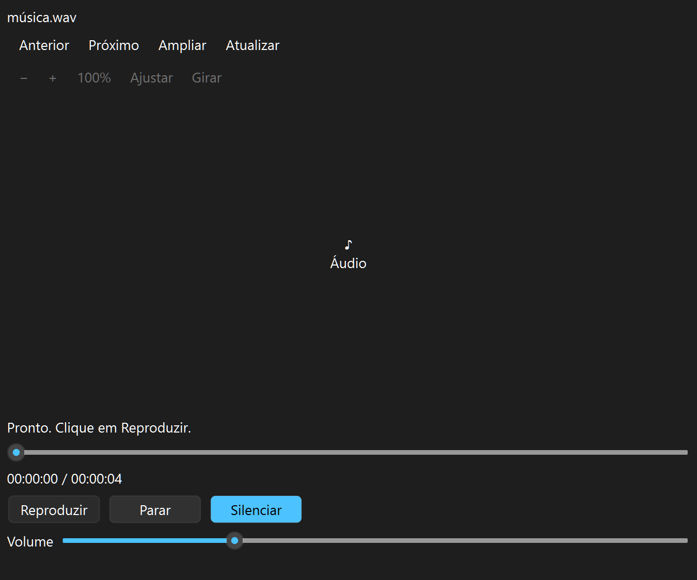
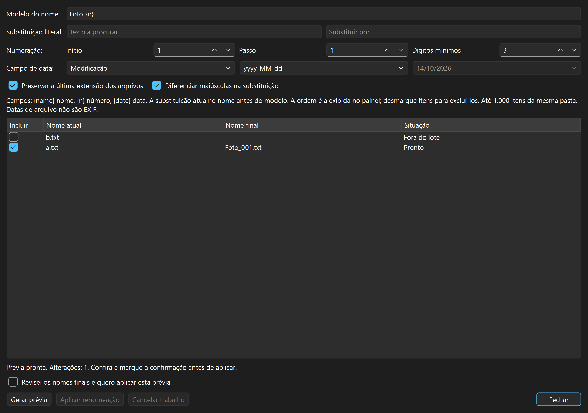

# Manual do Directory Open 0.11

## Recursos e atalhos

- Dois painéis com listas reais, ordenação e seleção múltipla.
- Árvore de pastas e atalhos para locais comuns.
- Abas com histórico independente e filtros por nome.
- Voltar, avançar, pasta acima e endereço editável.
- Tema claro/escuro e alternância entre um ou dois painéis.
- Visualizador de imagens, texto, PDF, áudio e vídeo, com carregamento em segundo plano.
- Abertura externa explícita pelo botão Abrir; duplo clique em arquivo seleciona
  para pré-visualização, e em pasta navega.
- Copiar caminho para a área de transferência.
- Copiar arquivos e pastas para o outro painel, com seleção múltipla,
  confirmação do destino, progresso e cancelamento pelo mecanismo do Windows.
- Perguntar em conflitos ou manter ambos com um nome gerado pelo Windows.
- Relatório por item: copiado, ignorado, cancelado, parcial, não iniciado ou erro.
- Mover arquivos e pastas entre painéis, com confirmação do destino e conflitos.
- Renomear um item por vez, incluindo nomes Unicode e mudanças de maiúsculas.
- Criar pastas no painel ativo, validando nomes e recusando colisões.
- Enviar itens à Lixeira do Windows após confirmação explícita.
- Recuperar abas, pastas, filtros, ordenação, painel ativo, tema e layout.
- Menu de contexto nas listas, com os mesmos comandos e confirmações da barra.
- Copiar, recortar e colar arquivos pela área de transferência do Windows.
- Arrastar entre os painéis, com cópia padrão e movimentação com Shift.
- Busca por nome em subpastas, em segundo plano, com cancelamento e resultados em nova aba.
- Favoritos editáveis na barra e na lateral, guardados junto da sessão.
- Comparação de pastas por tamanho/data ou conteúdo, com subpastas e cancelamento.
- Exibição por pasta: detalhes, somente nomes ou miniaturas, com tamanho, colunas e ordenação compartilhados entre painéis.

Atalhos: Ctrl+T nova aba, Ctrl+W fechar aba, Ctrl+L endereço, Ctrl+F filtro,
Alt+Left voltar, Alt+Right avançar, Alt+Up pasta acima, F6 dois painéis,
F7 pré-visualização, F8 copiar seleção, Ctrl+M mover, F2 renomear,
Ctrl+Shift+N nova pasta, Delete enviar à Lixeira, Ctrl+O abrir e
Ctrl+Shift+C copiar caminho. Delete atua na lista de arquivos; em campos de
texto, continua editando normalmente.
Ctrl+C copia arquivos, Ctrl+X prepara o recorte e Ctrl+V cola no painel ativo.
Esses três atalhos só atuam em arquivos quando a lista tem o foco; nos campos
de texto, mantêm a edição normal. O botão Colar também está na barra de comandos.
Ctrl+Shift+F abre a busca recursiva; Ctrl+D adiciona a pasta atual aos favoritos.
Ctrl+Shift+K abre a comparação das pastas dos dois painéis. Ctrl+F2 abre a renomeação em lote.

## Visualizar arquivos

Selecione um arquivo e use **F7** para mostrar o painel. **F3** ou **Ampliar** abre
o mesmo visualizador numa janela maior; **F11** alterna tela cheia nessa janela.
**Esc** fecha a janela ampliada e retorna ao gerenciador. O painel também pode ser
movido para a parte inferior ou destacado. **Anterior/Próximo** percorrem os arquivos
visíveis na ordem da lista, respeitando o filtro e ignorando pastas.

**Imagens:** zoom, Ctrl+roda do mouse, 100%, ajuste ao painel e rotação da visualização.
A rotação não grava o arquivo. São aceitos os formatos reconhecidos pelos plugins Qt
distribuídos (PNG/JPEG verificados); imagens de vários quadros mostram o primeiro.
Imagens maiores podem usar uma prévia reduzida, identificada no rodapé; 100% representa
as dimensões originais, mas não recupera detalhes descartados da prévia reduzida.

**Texto:** leitura sem edição ou execução de HTML/scripts, procura anterior/próxima
com retorno ao início/fim e escolha de codificação. Automática reconhece BOM de
UTF-8/UTF-16/UTF-32 e tenta UTF-8; se inválido, oferece Windows-1252, indicado como
alternativa. Há escolhas explícitas de UTF-8, UTF-16 LE/BE, Windows-1252 e ISO-8859-1.
Sem BOM, UTF-16 precisa ser escolhido explicitamente em arquivos com extensão textual;
arquivos identificados como binários não são convertidos automaticamente.

**PDF:** renderização pelo componente nativo Windows.Data.Pdf, páginas, zoom e ajuste.
Não é necessário instalar Qt PDF, Adobe Reader ou outro leitor. O SDK Windows
fornece os cabeçalhos para compilar. As páginas são imagens: nesta etapa,
não há seleção/pesquisa de texto de PDF, formulários, links interativos ou entrada de
senha. PDFs protegidos ou inválidos mostram um aviso. Áudio/vídeo e Office ficam para
outra etapa.

**Áudio e vídeo:** selecione um arquivo e use F7/F3. Clique em **Reproduzir**;
a seleção carrega a mídia sem iniciar som ou reprodução. O botão alterna para
**Pausar**. **Parar** retorna ao início. A barra de posição permite buscar com
mouse ou teclado quando o arquivo oferece busca; há tempo atual/duração, volume
e **Silenciar**. Volume/silenciamento permanecem enquanto o visualizador existe.
Anterior/Próximo continuam seguindo a ordem e o filtro do painel. Não há avanço
automático no fim da mídia.

F3/Ampliar reutiliza o mesmo reprodutor e F11 alterna tela cheia na janela ampliada;
fechar essa janela devolve o visualizador ao painel. Trocar de arquivo, ocultar o
painel ou fechar o aplicativo encerra a reprodução e libera o dispositivo aberto.
Mover, renomear, enviar à Lixeira e abrir o lote também encerram a mídia antes da
confirmação; se cancelar a operação, use **Atualizar** para carregar novamente.

A leitura é local, pelo Qt Multimedia, sem carregar o arquivo inteiro em memória.
Extensões candidatas: WAV, MP3, FLAC, OGG, OPUS, AAC, M4A, WMA, MP4, M4V, MOV,
MKV, WEBM, AVI, WMV, MPG/MPEG, TS e 3GP. A extensão não garante um codec: um arquivo
inválido ou sem decodificador mostra o erro no visualizador. WAV PCM e AVI/MJPEG
foram verificados com fixtures próprias, incluindo quadros efetivamente decodificados.
Não é uma declaração de suporte a todos os codecs desses contêineres. Não há
playlists, URLs de streaming, captura, gravação, conversão ou editor de mídia.
Nenhum pacote externo de codecs é instalado pelo aplicativo.

**Atualizar** no visualizador relê o arquivo; em PDF, retorna à primeira página.
A prévia representa uma leitura do arquivo, não um acompanhamento contínuo de edições
feitas por outros programas. Mudanças de seleção descartam resultados antigos e
mantêm apenas a solicitação mais recente. O cache de PDF é validado pelo SHA-256 do
conteúdo relido antes de reutilizar o documento analisado; não mantém o arquivo aberto.

Limites desta etapa: imagens/PDF de até 64 MiB, imagens de origem até 128 megapixels,
bitmap de prévia até 4096×4096 e texto até 1 MiB (trechos maiores são indicados como
parciais). PDF pede páginas de até 1800×2400 pixels, considerando a escala de tela.
A memória interna dos decodificadores nativos pode variar. Uma operação nativa de
leitura/decodificação já em andamento precisa terminar antes do trabalhador encerrar;
o aplicativo aguarda no fechamento, sem abandonar threads ou arquivos.

O inicializador antigo `IniciarNavega.cmd` encaminha para `IniciarDirOpen.cmd` para
preservar atalhos. A sessão continua em `%LOCALAPPDATA%\Navega\session.json`, com
backup e proteção de concorrência; a troca de nome não move nem apaga preferências.
As variáveis de build `NAVEGA_*` existentes continuam válidas.

## Buscar e organizar favoritos

Clique em **Buscar** ou pressione **Ctrl+Shift+F**. A pasta inicial é a do painel
ativo. Digite parte do nome, sem distinção de maiúsculas, ou marque **Usar padrões**
para buscar, por exemplo, `*.pdf`. A busca inclui subpastas e itens ocultos, e
ignora links e junções. Ela examina nomes; não pesquisa dentro dos arquivos.
Duplo clique no resultado ou **Abrir pasta em nova aba** abre a pasta correspondente
no painel ativo. Um resultado de arquivo abre sua pasta; um resultado de pasta
abre a própria pasta. Os resultados são uma observação feita durante a busca,
e podem mudar quando outro programa altera os arquivos.

**Cancelar busca** mantém o que já foi encontrado. A lista distingue término,
cancelamento, falhas de acesso e limites. Cada busca permite até 10.000 resultados,
1.000.000 de itens examinados e 256 níveis de pastas; restrinja o local ou o nome
se um limite for atingido. Até 20 detalhes de erros são retidos no aviso da busca.
O cancelamento é cooperativo: uma leitura do Windows, especialmente em rede,
pode precisar terminar antes de encerrar. A janela fecha depois do trabalhador;
não abandona uma leitura em curso.

O menu **Favoritos** inclui **Adicionar pasta atual** e **Organizar favoritos**;
os mesmos comandos ficam em **Pastas**. No organizador, dê dois cliques no nome
ou no caminho para editar. Use **Subir**, **Descer** e **Remover** para organizar
até 64 atalhos. **Guardar** aplica as alterações; **Cancelar** preserva a lista.
Remover um favorito não remove arquivos nem pastas.

Os favoritos são persistidos ao fechar normalmente o aplicativo, com a mesma
proteção e cópia de segurança da sessão. Sessões anteriores recebem os atalhos
iniciais uma vez; uma lista vazia salva continua vazia. Caminhos indisponíveis
permanecem guardados, e abrir um deles mostra um aviso sem substituir a pasta atual.

## Comparar pastas

Abra as duas pastas nos painéis e clique em **Comparar pastas…** na barra ou em
**Ferramentas**; o atalho é **Ctrl+Shift+K**. Os dois endereços podem ser alterados
na janela. Marque **Incluir subpastas** para percorrer toda a árvore ou desmarque
para comparar apenas o nível atual. Itens ocultos são incluídos; links e junções
não são seguidos nem comparados. A própria raiz não pode ser link/junção.

Clique em **Comparar**. Cada linha mostra o caminho relativo, o resultado e os
metadados de cada lado. **Somente à esquerda/direita** significa que a ausência
foi confirmada no escopo lido. Nomes devem corresponder exatamente, inclusive
maiúsculas/minúsculas: nomes diferentes são itens distintos. Pastas correspondentes
aparecem como **Pasta em ambos**; essa linha não confirma igualdade da árvore.
Os arquivos internos têm seus próprios resultados.

O modo inicial compara tamanho e data de modificação. **Tamanho/data iguais**
é uma coincidência de metadados; o conteúdo permanece não conferido.
**Tamanho/data diferentes** também não significa, por si só, bytes diferentes.
Marque **Conferir conteúdo dos arquivos** e execute novamente para comparar bytes
inclusive quando as datas forem diferentes. Tamanhos distintos comprovam diferença
sem leitura de conteúdo. Para arquivos de tamanho igual, todos os bytes precisam
coincidir para aparecer **Conteúdo igual (bytes conferidos)**; uma divergência
permite encerrar a leitura daquele par. Não usa apenas hashes nem amostras.

**Mostrar somente diferenças e pendências** esconde as correspondências, incluindo
coincidências de tamanho/data no modo inicial. Desmarque para inspecioná-las.
Selecione um resultado e use **Abrir à esquerda/direita em nova aba** para abrir
sua pasta no painel correspondente. Um resultado de pasta abre a própria pasta;
um arquivo abre a pasta que o contém. O botão do lado ausente fica desabilitado.

Erros, arquivos em uso ou alterados durante a conferência são **Não confirmado**.
Uma pasta sem acesso não é tratada como vazia: itens correspondentes encontrados
no outro lado ficam pendentes se sua ausência não puder ser confirmada.
**Cancelar comparação** preserva apenas os resultados já examinados e indica
parcialidade. Fechar aguarda o trabalhador encerrar, sem abandonar a leitura.
Uma chamada de rede em andamento pode precisar terminar antes do cancelamento.

Limites: 5.000 itens por lado, 128 níveis e orçamento de 2.097.152 caracteres UTF-16
por inventário para caminhos e chaves. Até 10.000 linhas e 20 detalhes de erros.
Limites atingidos são explícitos e não confirmam ausência em trechos não lidos.
A leitura usa blocos de 256 KiB por lado; não carrega arquivos inteiros em memória.
Durante a conferência, os arquivos abertos não aceitam compartilhamento de escrita
ou exclusão; programas que já escrevem podem impedir a leitura estável.

A comparação é uma observação durante a leitura, sem snapshot atômico das duas
árvores e sem acompanhamento posterior. Alterações externas podem tornar um
resultado antigo; compare novamente para atualizar. Esta etapa inspeciona os dados:
não copia, move, apaga nem sincroniza arquivos. Use os comandos existentes dos
painéis para qualquer operação posterior, com as confirmações habituais.

## Miniaturas de imagens

No menu **Exibição** de cada painel, escolha **Miniaturas**. A grade mantém pastas
e outros arquivos com seus ícones e mostra as imagens dos formatos reconhecidos
pelos plugins Qt instalados, identificadas pela extensão. Em **Tamanho das miniaturas**,
escolha 96, 144, 192 ou 256 px. **Guardar exibição desta pasta** memoriza o modo e
o tamanho junto da ordenação; os dois painéis usam a mesma preferência ao abrir
essa pasta. **Detalhes** e **Somente nomes** retornam à lista, preservando a seleção.

Seleção múltipla, filtro, ordenação, F3/F7, copiar/recortar/colar, arraste e menu de
contexto usam os mesmos comandos e confirmações da lista. Os nomes longos são
abreviados na grade; passe o mouse para ver o caminho completo. Imagens inválidas,
sem acesso ou acima dos limites mantêm o ícone com uma indicação; a dica mostra
o motivo. PDFs, vídeos, documentos e pastas têm ícones nesta etapa.

Somente imagens visíveis entram na fila, com até 128 solicitações por painel e
256 no conjunto. Em telas excepcionalmente grandes, imagens além dessa cobertura
mantêm o ícone; reduzir a janela ou aumentar as miniaturas reduz a quantidade visível.
Há um trabalhador de miniaturas por janela e um cache compartilhado de até 64 MiB de bitmaps e
256 entradas, sem arquivos de cache nas pastas. A miniatura retida tem até 256×256
pixels e é ampliada pela tela quando necessário; use F3 para examinar detalhes.
A leitura respeita 64 MiB por arquivo, 128 megapixels e a orientação EXIF. Somente
o primeiro quadro é usado; PNG/JPEG e orientação JPEG foram verificados.

O cache distingue caminho, tamanho e data de modificação observados pelo modelo.
**Atualizar (F5)** limpa as miniaturas da janela e relê a pasta; use-o após uma
edição que tenha preservado esses metadados. Mudanças de pasta ou filtro substituem
a fila pendente; uma leitura/decodificação em curso pode precisar terminar, inclusive
no fechamento. A memória de trabalho dos decodificadores é adicional ao cache.

## Exibição por pasta

Use **Exibição**, ao lado do endereço de cada painel. **Detalhes** mostra as
quatro colunas; **Somente nomes** mantém apenas os nomes; **Miniaturas** usa a grade. Em **Colunas**, escolha
Tamanho, Tipo e Modificado em. Nome permanece visível e ocupa o espaço disponível.
Arraste os cabeçalhos das outras colunas para reorganizá-las e suas divisórias
para ajustar larguras. **Ordenar por** também funciona quando a coluna está oculta.

**Guardar exibição desta pasta** memoriza modo, visibilidade, ordem e largura das
colunas, tamanho das miniaturas, coluna de ordenação e sentido. A configuração passa a valer nos dois
painéis, nas abas e ao voltar à pasta. Filtros continuam independentes por aba.
Alterações posteriores precisam ser guardadas novamente. **Restaurar exibição
padrão** altera a apresentação atual; use Guardar para substituir a preferência.

**Esquecer exibição desta pasta** retorna à configuração de base do painel.
**Exibições guardadas…** permite esquecer várias preferências, incluindo as de
pastas indisponíveis. **Cancelar** preserva a lista; remover uma preferência não
remove arquivos. Até 256 pastas podem ter exibição guardada, sem descarte automático.
Larguras das colunas auxiliares ficam entre 32 e 8192 pixels para manter a interface
utilizável. O modo e o tamanho das miniaturas também podem ser guardados.

As preferências são gravadas ao fechar normalmente, junto da sessão e com as
mesmas proteções e backup. Nada é escrito dentro das pastas navegadas. Configurações
anteriores continuam válidas. Pastas indisponíveis mantêm sua referência; sua
preferência não é aplicada à pasta pessoal usada provisoriamente. A chave usa o
caminho completo resolvido pela navegação, sem converter maiúsculas em minúsculas;
renomear ou mover uma pasta não transfere sua preferência automaticamente.

## Copiar entre painéis

1. Abra a pasta de destino em um painel e selecione os itens no outro.
2. Clique em **Copiar** ou pressione **F8**.
3. Confira o destino. Use **Escolher** para selecionar outra pasta, se desejar.
4. Escolha **Perguntar** ou **Manter os dois** e confirme **Copiar**.
5. Acompanhe o progresso no Windows e na barra de status. Use o cancelamento
   da janela do Windows ou o comando **Cancelar operação** no Directory Open.

Os originais permanecem na origem. O cancelamento conserva as cópias já
concluídas e apresenta o resultado por item; não desfaz todo o lote.
Erros não são apresentados como sucesso. O destino é revalidado na execução,
e não é permitido copiar uma pasta para dentro dela mesma ou para sua própria
pasta de origem. Uma operação é executada por vez, em uma thread STA
dedicada ao `IFileOperation`; a interface permanece disponível.

Links simbólicos e junções, inclusive dentro de pastas selecionadas, são
recusados nesta versão. Pastas normais, subpastas e pastas vazias são copiadas.
A prechecagem da árvore ocorre na thread de cópia e pode ser cancelada.
Nome e data de modificação de arquivo foram verificados em fixtures Unicode;
a preservação de todos os metadados, ACLs e propriedades de arquivos especiais
não foi validada. Não há rollback próprio nem fila de múltiplos trabalhos.

## Renomear em lote

Selecione os arquivos/pastas de uma mesma pasta e use **Ctrl+F2**, **Renomear em
lote…** na barra, no menu Ferramentas ou no menu de contexto. F2 continua renomeando
um único item. Até 1.000 itens e 2 MiB de caminhos UTF-16 por lote; a ordem inicial
é a ordem visual do painel, independentemente da ordem dos cliques de seleção.

O modelo aceita **{name}** (nome), **{n}** (número) e **{date}** (data). Por exemplo,
**Viagem_{date}_{n}** produz nomes como Viagem_2027-01-03_001.jpg. Escolha início,
passo e quantidade mínima de dígitos. **Substituição literal** altera texto do nome
antes de aplicar o modelo, com distinção de maiúsculas opcional. Conteúdo inserido
por nome/substituição não volta a ser interpretado como campos do modelo.

**Preservar a última extensão** fica marcado inicialmente para arquivos. Em
arquivo.tar.gz, conserva .gz; pastas não têm extensão separada e nomes iniciados
por ponto sem outro ponto são tratados como nome inteiro. Desmarque para incluir
a extensão no campo {name} e na substituição. Para {date}, escolha modificação,
criação no sistema de arquivos ou data do calendário. Formatos: yyyy-MM-dd,
yyyyMMdd ou yyyy-MM-dd_HHmmss; a data escolhida usa 00:00:00. Datas do sistema
são apresentadas no horário local e não são datas EXIF de captura.

Desmarque linhas para excluí-las. Após mudar opções/inclusões, clique em **Gerar
prévia**. A lista mostra nome atual, nome final e situação. A confirmação anterior
é invalidada ao editar; **Aplicar renomeação** só habilita depois de uma prévia
válida, com alteração, e da marcação **Revisei os nomes finais…**. Enter não aplica
o lote por padrão. Nomes reservados/inválidos, destinos já ocupados e nomes finais
duplicados bloqueiam todo o lote. Trocas/ciclos de nomes ocupados não são resolvidos
por nomes temporários nesta etapa; ajuste a prévia. Links/junções são recusados.

Ao aplicar, as origens e os destinos são revalidados antes da primeira mudança;
um item alterado/substituído desde a prévia exige gerar outra. Cada renomeação usa
o item aberto e nunca substitui um destino. Conflito ou falha surgido durante o
lote interrompe os próximos itens. **Cancelar trabalho** conserva nomes já
concluídos; o relatório identifica concluídos, sem alteração, não iniciados e erros.
Fechar durante um trabalho solicita cancelamento e aguarda seu encerramento.

Não há transação de toda a pasta nem desfazer automático. A prévia e o relatório
permanecem na janela até fechar; esta etapa não grava um histórico de reversão
persistente. Nenhuma regra de renomeação escreve no conteúdo dos arquivos.

## Outras operações

**Mover:** selecione os itens e use Ctrl+M. O destino sugerido é o outro painel.
Itens concluídos saem da origem; cancelar conserva as movimentações concluídas
e mantém os itens pendentes onde estão. Conflitos usam as mesmas escolhas da cópia.

**Renomear:** selecione um único item e use F2. Confira o nome completo, inclusive
a extensão. Nomes reservados, caminhos e colisões são recusados. **Nova pasta**
(Ctrl+Shift+N) cria uma pasta na localização do painel ativo.

**Lixeira:** selecione os itens e use Delete ou o botão Lixeira. Confira a lista e
clique em **Enviar à Lixeira**. Enter cancela a confirmação por padrão. A operação
usa somente `ITransferSource::RecycleItem`, sem alternativa de exclusão definitiva.
Nesta versão, somente unidades locais fixas são aceitas; rede e unidades removíveis
são recusadas. Erros e transferências não confirmadas são apresentados por item.
A barra de status mostra o progresso por item; o cancelamento é atendido entre
os itens selecionados. Uma pasta grande já em processamento pode precisar terminar
antes do encerramento. Restaure os itens pela Lixeira do Windows.

Uma operação em curso desabilita os comandos que alteram arquivos. Fechar a janela
durante uma operação permite solicitar seu cancelamento e aguardar o encerramento.
Cancelar não desfaz itens já concluídos. Os testes nativos usam dados temporários
e restauram apenas os itens que eles mesmos enviaram à Lixeira.

Os modelos de arquivos são somente leitura; alterações passam pelo motor de
operações após confirmação, inclusive quando iniciadas por colar ou arrastar.
Links e junções selecionados são
recusados. Copiar, mover e reciclar também recusam links encontrados dentro da
árvore selecionada; renomear uma pasta normal não percorre seu conteúdo.
Ainda não existem arquivos compactados, plugins ou paridade de
recursos com o Directory Opus. A árvore compartilhada acompanha o painel ativo.

## Sessão e menu de contexto

Ao fechar normalmente, o Directory Open guarda as pastas e filtros de cada aba, a aba
selecionada, a ordenação de cada painel, o painel ativo, o tema, a árvore,
a pré-visualização, a divisão dos painéis e o tamanho/posição da janela.
Na próxima abertura pelo `IniciarDirOpen.cmd`, essas opções são recuperadas.
O histórico Voltar/Avançar e a seleção de arquivos começam novos em cada sessão.
O Qt ajusta a janela se a tela disponível for menor que a usada anteriormente.

O registro fica em `%LOCALAPPDATA%\Navega\session.json`. A gravação é atômica,
com o registro anterior em `session.json.bak`. Se o principal estiver incompleto,
a cópia válida pode ser recuperada; o principal danificado é preservado em outro
arquivo antes de uma nova gravação. Formatos de versões mais recentes não são
sobrescritos. Outra janela que tenha mudado o registro impede uma gravação
concorrente sobre ele, com aviso ao fechar. Falhas não modificam os arquivos
que você navega. A sessão é guardada no fechamento normal, não a cada navegação.

Pastas salvas indisponíveis usam temporariamente a pasta pessoal. O endereço
recebe um aviso, e a referência original é mantida para tentar novamente na
próxima abertura. Navegar manualmente para outra pasta substitui essa referência.

Clique com o botão direito em um item para abrir o menu. Um item já selecionado
mantém a seleção múltipla; outro item passa a ser a seleção, e o espaço vazio
limpa a seleção. O menu oferece abrir, abrir pasta em nova aba, copiar, mover,
renomear, Lixeira, nova pasta, copiar caminhos e atualizar. Operações usam os
mesmos diálogos existentes. Copiar caminhos inclui todos os itens selecionados,
um por linha. O menu também pode ser aberto pela tecla Menu/Shift+F10.

Para iniciar sem ler/gravar preferências, use `DirOpen.exe --no-session`.
`--session-file CAMINHO` permite um registro independente para testes; `--left`
e `--right` substituem a pasta da aba ativa somente do painel indicado.
Capturas de validação não usam a sessão pessoal, a menos que um registro de teste
seja indicado. Os testes não leem nem gravam as preferências pessoais do usuário.

## Área de transferência e arraste

Selecione os arquivos ou pastas e use **Ctrl+C** para copiar ou **Ctrl+X** para
recortar. Recortar apenas prepara a seleção e atenua seus nomes; nada é removido
nessa etapa. Abra o destino, deixe sua lista com o foco e use **Ctrl+V** ou **Colar**.
Confira os itens, a pasta e a escolha de conflitos no mesmo diálogo das operações
entre painéis. Cancelá-lo mantém os arquivos e a seleção preparada intactos.

A cópia permanece disponível para outros destinos. Ao mover, somente itens
confirmados como concluídos são retirados da seleção preparada; pendências
permanecem para uma nova tentativa. Uma área de transferência alterada durante
o trabalho é preservada. Falha ao publicar/copiar informa que é necessário tentar
novamente; falha ao atualizar a seleção após mover não é tratada como falha dos
arquivos já movidos, e aparece no relatório. Os dados publicados usam os formatos
de arquivos e de ação preferida do Windows, sem comandos adicionais de exclusão.

Para arrastar entre os painéis, solte no espaço da lista para usar sua pasta atual,
ou sobre uma pasta para usá-la como destino. Por padrão, a ação é **Copiar**;
segure **Shift** para **Mover**, e **Ctrl** para manter cópia. O diálogo de confirmação
aparece depois de soltar. Cancelar não remove os originais. Não há movimentação
automática do modelo de arquivos nem remoção de linhas para simular uma exclusão.

Arquivos arrastados de outro aplicativo podem ser recebidos como cópia.
Movimentação de um arraste externo e arrastar do Directory Open para outro aplicativo
não estão habilitados nesta etapa. Links, URLs web, anexos virtuais e atalhos
criados por Alt/Ctrl+Shift não são operações de transferência suportadas.
Uma confirmação ou operação em curso bloqueia novas transferências.
Listas individuais são limitadas a 16.384 itens e 4 MiB de caminhos; selecionar
uma pasta transfere seu conteúdo sem contar seus filhos como itens dessa lista.
